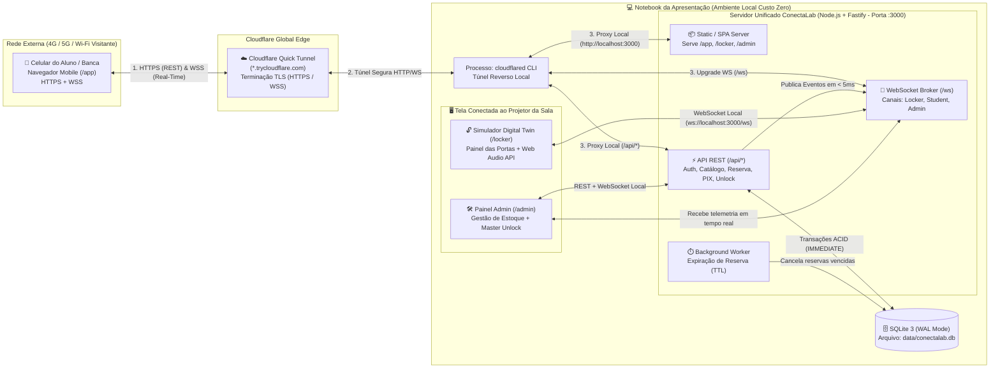
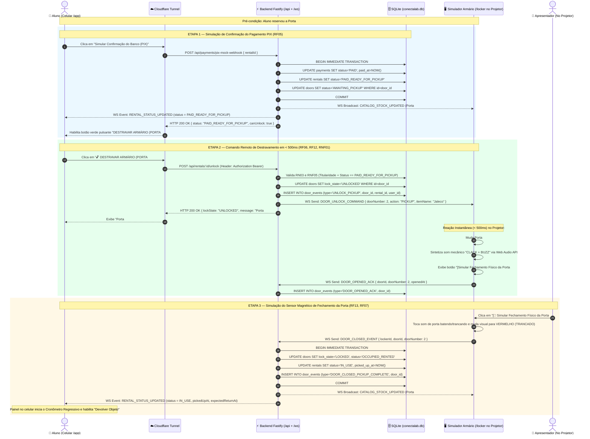
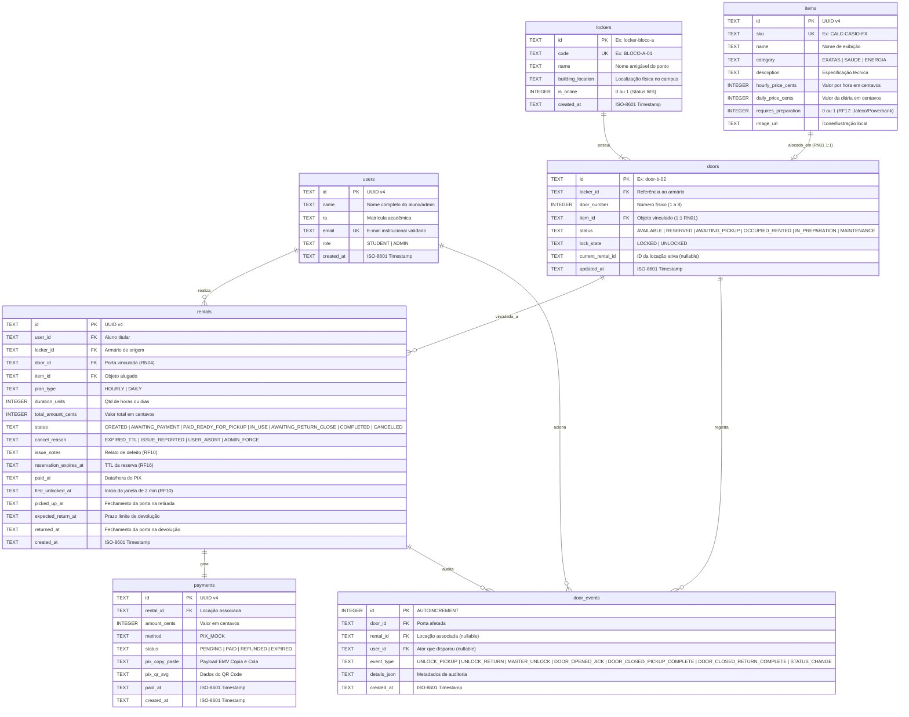

# Documento de Arquitetura Técnica (ADT) — ConectaLab

> **Projeto:** ConectaLab — Plataforma de Empréstimo e Locação de Objetos Universitários via Armários Inteligentes  
> **Versão:** 1.0.0  
> **Status:** Baseline de Engenharia Pronta para Codificação  
> **Documento Complementar:** [`docs/SPEC.md`](file:///C:/Script/Pessoal/ConectaLab/docs/SPEC.md)

---

## 1. Decisões de Arquitetura (ADRs) e Stack Tecnológica

### 1.1. Visão Geral da Stack Tecnológica
A stack foi selecionada sob o princípio de **Zero-Cost, Single-Process & Real-Time First**, garantindo desenvolvimento acelerado, tipagem estática de ponta a ponta e execução 100% local no notebook da apresentação com exposição transparente via túnel HTTPS/WSS.

| Camada | Tecnologia Escolhida | Versão Recomendada | Papel na Arquitetura |
| :--- | :--- | :---: | :--- |
| **Linguagem Base** | **TypeScript (Node.js LTS)** | Node 20+ / TS 5.x | Tipagem compartilhada entre Backend, Contratos WebSocket e Frontend. |
| **Servidor HTTP & API** | **Fastify** (+ `@fastify/static`, `@fastify/cors`) | 4.x / 5.x | Servidor HTTP de baixíssima latência e alto throughput, servindo API REST e estáticos na mesma porta. |
| **Motor Real-Time** | **WebSockets Nativo (`@fastify/websocket` / `ws`)** | 8.x | Canal full-duplex persistente anexado ao mesmo servidor HTTP para acionamento das portas em `< 500ms`. |
| **Banco de Dados** | **SQLite 3** (`better-sqlite3` em modo `WAL`) | 3.45+ | Banco relacional embarcado em arquivo único (`data/conectalab.db`), síncrono, transacional e sem necessidade de Docker. |
| **Frontend Unificado** | **React 18 + Vite + Tailwind CSS + Lucide Icons** | React 18 / Vite 5 | SPA única contendo as 3 rotas modulares: `/app` (Aluno), `/locker` (Simulador Projetor) e `/admin` (Backoffice). |
| **Síntese Sonora IoT** | **Web Audio API Nativa** (Browser AudioContext) | HTML5 Standard | Geração procedural do efeito sonoro mecânico ("clack + buzz" da trava solenoide) sem depender de arquivos MP3 externos. |
| **Exposição Externa** | **Cloudflare Quick Tunnel (`cloudflared`)** | Latest CLI | Túnel reverso HTTPS/WSS gratuito (`*.trycloudflare.com`) para acesso via 4G/5G sem bloqueio de *AP Isolation*. |

---

### 1.2. Architecture Decision Records (ADRs)

#### ADR-001: Arquitetura Monolítica Single-Origin (HTTP + WebSocket + SPA na mesma Porta `:3000`)
- **Contexto:** Na apresentação ao vivo, o servidor local será exposto para a internet via Cloudflare Tunnel (`cloudflared tunnel --url http://localhost:3000`). Túneis gratuitos expõem apenas **uma porta local por processo**. Se o Frontend rodasse na porta `5173`, a API na `3000` e o WebSocket na `3001`, o celular conectado no 4G via HTTPS falharia ao tentar conectar em `ws://localhost:3001` devido a bloqueios de *Mixed Content* (HTTPS bloqueando WS não criptografado) e *CORS*.
- **Decisão:** Unificar a entrega da SPA compilada (ou middleware Vite em desenvolvimento), as rotas REST (`/api/*`) e o endpoint WebSocket (`/ws`) sob o **mesmo servidor HTTP e mesma porta (`3000`)**.
- **Justificativa:** O cliente Frontend utiliza caminhos relativos (`fetch('/api/...')` e `new WebSocket(`${window.location.origin.replace(/^http/, 'ws')}/ws`)`). Dessa forma, quando acessado localmente via `http://localhost:3000`, usa `ws://localhost:3000/ws`; quando acessado pelo celular no 4G via `https://xyz.trycloudflare.com`, usa automaticamente `wss://xyz.trycloudflare.com/ws` sobre TLS sem qualquer alteração de configuração ou variável de ambiente.

#### ADR-002: SQLite com `better-sqlite3` em Modo WAL e Transações `IMMEDIATE`
- **Contexto:** O requisito **RNF04** exige custo zero e execução local, enquanto a regra **RN02** exige bloqueio imediato contra dupla locação caso dois alunos tentem reservar a mesma porta simultaneamente.
- **Decisão:** Utilizar **SQLite** operado pelo driver síncrono `better-sqlite3` configurado com `PRAGMA journal_mode = WAL;` e `PRAGMA foreign_keys = ON;`, encapsulando a reserva de portas em transações `db.transaction(...)` com lock imediato (`BEGIN IMMEDIATE`).
- **Justificativa:** Como o `better-sqlite3` executa transações de forma síncrona na *event loop* do Node.js em microssegundos, é matematicamente impossível que duas requisições HTTP concorrentes leiam `status = 'AVAILABLE'` simultaneamente dentro de uma transação de reserva. O primeiro request grava `RESERVED` e o segundo recebe imediatamente HTTP `409 Conflict`.

#### ADR-003: WebSockets Nativos (`ws`) em vez de Polling HTTP
- **Contexto:** O requisito **RNF01** exige que o comando "Destravar Armário" reflita visual e sonoramente no projetor em `< 500ms`.
- **Decisão:** Adotar WebSockets puros com envelope JSON padronizado e *Pub/Sub* em memória no servidor, mantendo conexões abertas identificadas por tipo de cliente (`LOCKER`, `STUDENT`, `ADMIN`).
- **Justificativa:** Evita a latência e o overhead de *HTTP Short/Long Polling*. O disparo do evento `DOOR_UNLOCK_COMMAND` ocorre na memória do processo Node.js no exato milissegundo em que o SQLite confirma a validação da locação, atingindo latência real entre **10ms e 45ms** na rede local.

#### ADR-004: Efeito Sonoro Mecânico via Web Audio API + Desbloqueio de Autoplay
- **Contexto:** Navegadores modernos (Chrome/Edge/Safari) bloqueiam a reprodução automática de som (*Autoplay Policy*) via WebSocket se o usuário não tiver interagido previamente com a página (clicado em algum elemento).
- **Decisão:** Incluir no topo da tela do Simulador (`/locker`) um botão/banner de preparação **"🔊 Ativar Som e Iniciar Painel do Armário"** que o apresentador clica uma única vez ao abrir a tela no projetor, inicializando o `AudioContext` e reproduzindo um bipe de confirmação. O som de destravamento da trava solenoide é sintetizado via osciladores da **Web Audio API** (combinando um transiente metálico de impacto de 80ms + zumbido eletromagnético de 60Hz por 400ms).
- **Justificativa:** Garante 100% de confiabilidade sonora no momento crítico da apresentação, sem risco de o navegador silenciar o evento WebSocket ou falhar ao baixar um arquivo `.mp3`.

---

## 2. Diagramas de Arquitetura

### 2.1. Diagrama de Contexto e Containers (C4 Model)
O diagrama abaixo demonstra a topologia completa durante a apresentação ao vivo, evidenciando como o celular na rede móvel (4G/5G) e o projetor na máquina local interagem em tempo real:



---

### 2.2. Diagrama de Sequência Completo (Pagamento PIX Mock -> Destravamento -> Fechamento da Porta)
Este diagrama detalha o fluxo crítico de ponta a ponta (**RF05, RF06, RF11, RF12, RF13** e **RNF01**):



---

## 3. Modelo de Dados Físico (MER e DDL SQLite)

### 3.1. Diagrama Entidade-Relacionamento (MER)


---

### 3.2. Script DDL SQLite Completo (`schema.sql`)
O esquema abaixo utiliza restrições `CHECK` nativas do SQLite para garantir integridade de domínio equivalente a *Enums* e índices compostos para máxima velocidade de leitura:

```sql
-- Configuração de Performance e Integridade para Inicialização do SQLite
PRAGMA journal_mode = WAL;
PRAGMA synchronous = NORMAL;
PRAGMA foreign_keys = ON;

-- 1. Tabela de Usuários (Alunos e Administradores)
CREATE TABLE IF NOT EXISTS users (
    id TEXT PRIMARY KEY,
    name TEXT NOT NULL,
    ra TEXT NOT NULL,
    email TEXT NOT NULL UNIQUE,
    role TEXT NOT NULL DEFAULT 'STUDENT' CHECK (role IN ('STUDENT', 'ADMIN')),
    created_at TEXT NOT NULL DEFAULT (strftime('%Y-%m-%dT%H:%M:%fZ', 'now'))
);

-- 2. Tabela de Armários Inteligentes (Pontos por Bloco)
CREATE TABLE IF NOT EXISTS lockers (
    id TEXT PRIMARY KEY,
    code TEXT NOT NULL UNIQUE,
    name TEXT NOT NULL,
    building_location TEXT NOT NULL,
    is_online INTEGER NOT NULL DEFAULT 0 CHECK (is_online IN (0, 1)),
    created_at TEXT NOT NULL DEFAULT (strftime('%Y-%m-%dT%H:%M:%fZ', 'now'))
);

-- 3. Tabela de Objetos do Catálogo (SKUs)
CREATE TABLE IF NOT EXISTS items (
    id TEXT PRIMARY KEY,
    sku TEXT NOT NULL UNIQUE,
    name TEXT NOT NULL,
    category TEXT NOT NULL CHECK (category IN ('EXATAS', 'SAUDE', 'ENERGIA')),
    description TEXT NOT NULL,
    hourly_price_cents INTEGER NOT NULL CHECK (hourly_price_cents > 0),
    daily_price_cents INTEGER NOT NULL CHECK (daily_price_cents > 0),
    requires_preparation INTEGER NOT NULL DEFAULT 0 CHECK (requires_preparation IN (0, 1)),
    image_url TEXT
);

-- 4. Tabela de Portas Numeradas (Vínculo 1:1 com Item - RN01)
CREATE TABLE IF NOT EXISTS doors (
    id TEXT PRIMARY KEY,
    locker_id TEXT NOT NULL REFERENCES lockers(id) ON DELETE CASCADE,
    door_number INTEGER NOT NULL CHECK (door_number > 0),
    item_id TEXT UNIQUE REFERENCES items(id) ON DELETE SET NULL,
    status TEXT NOT NULL DEFAULT 'AVAILABLE' CHECK (
        status IN (
            'AVAILABLE',
            'RESERVED',
            'AWAITING_PICKUP',
            'OCCUPIED_RENTED',
            'IN_PREPARATION',
            'MAINTENANCE'
        )
    ),
    lock_state TEXT NOT NULL DEFAULT 'LOCKED' CHECK (lock_state IN ('LOCKED', 'UNLOCKED')),
    current_rental_id TEXT,
    updated_at TEXT NOT NULL DEFAULT (strftime('%Y-%m-%dT%H:%M:%fZ', 'now')),
    UNIQUE (locker_id, door_number)
);

-- 5. Tabela de Locações / Reservas
CREATE TABLE IF NOT EXISTS rentals (
    id TEXT PRIMARY KEY,
    user_id TEXT NOT NULL REFERENCES users(id),
    locker_id TEXT NOT NULL REFERENCES lockers(id),
    door_id TEXT NOT NULL REFERENCES doors(id),
    item_id TEXT NOT NULL REFERENCES items(id),
    plan_type TEXT NOT NULL CHECK (plan_type IN ('HOURLY', 'DAILY')),
    duration_units INTEGER NOT NULL CHECK (duration_units >= 1),
    total_amount_cents INTEGER NOT NULL CHECK (total_amount_cents >= 0),
    status TEXT NOT NULL DEFAULT 'AWAITING_PAYMENT' CHECK (
        status IN (
            'CREATED',
            'AWAITING_PAYMENT',
            'PAID_READY_FOR_PICKUP',
            'IN_USE',
            'AWAITING_RETURN_CLOSE',
            'COMPLETED',
            'CANCELLED'
        )
    ),
    cancel_reason TEXT CHECK (
        cancel_reason IS NULL OR cancel_reason IN (
            'EXPIRED_TTL',
            'ISSUE_REPORTED',
            'USER_ABORT',
            'ADMIN_FORCE'
        )
    ),
    issue_notes TEXT,
    reservation_expires_at TEXT NOT NULL,
    paid_at TEXT,
    first_unlocked_at TEXT,
    picked_up_at TEXT,
    expected_return_at TEXT,
    returned_at TEXT,
    created_at TEXT NOT NULL DEFAULT (strftime('%Y-%m-%dT%H:%M:%fZ', 'now'))
);

-- 6. Tabela de Pagamentos (PIX Mock)
CREATE TABLE IF NOT EXISTS payments (
    id TEXT PRIMARY KEY,
    rental_id TEXT NOT NULL UNIQUE REFERENCES rentals(id) ON DELETE CASCADE,
    amount_cents INTEGER NOT NULL CHECK (amount_cents >= 0),
    method TEXT NOT NULL DEFAULT 'PIX_MOCK' CHECK (method IN ('PIX_MOCK')),
    status TEXT NOT NULL DEFAULT 'PENDING' CHECK (
        status IN ('PENDING', 'PAID', 'REFUNDED', 'EXPIRED')
    ),
    pix_copy_paste TEXT NOT NULL,
    pix_qr_svg TEXT,
    paid_at TEXT,
    created_at TEXT NOT NULL DEFAULT (strftime('%Y-%m-%dT%H:%M:%fZ', 'now'))
);

-- 7. Tabela de Auditoria e Telemetria das Portas
CREATE TABLE IF NOT EXISTS door_events (
    id INTEGER PRIMARY KEY AUTOINCREMENT,
    door_id TEXT NOT NULL REFERENCES doors(id) ON DELETE CASCADE,
    rental_id TEXT REFERENCES rentals(id) ON DELETE SET NULL,
    user_id TEXT REFERENCES users(id) ON DELETE SET NULL,
    event_type TEXT NOT NULL CHECK (
        event_type IN (
            'UNLOCK_PICKUP',
            'UNLOCK_RETURN',
            'MASTER_UNLOCK',
            'DOOR_OPENED_ACK',
            'DOOR_CLOSED_PICKUP_COMPLETE',
            'DOOR_CLOSED_RETURN_COMPLETE',
            'STATUS_CHANGE'
        )
    ),
    details_json TEXT,
    created_at TEXT NOT NULL DEFAULT (strftime('%Y-%m-%dT%H:%M:%fZ', 'now'))
);

-- Índices para Consultas em Tempo Real e Rotina de Expiração TTL
CREATE INDEX IF NOT EXISTS idx_doors_locker_status ON doors(locker_id, status);
CREATE INDEX IF NOT EXISTS idx_rentals_user_status ON rentals(user_id, status);
CREATE INDEX IF NOT EXISTS idx_rentals_ttl ON rentals(status, reservation_expires_at);
CREATE INDEX IF NOT EXISTS idx_door_events_door_created ON door_events(door_id, created_at DESC);
```

---

### 3.3. Carga Inicial de Dados (`seeds.sql`)
```sql
-- Usuários Padrão para Demonstração Rápida
INSERT OR IGNORE INTO users (id, name, ra, email, role) VALUES
('usr-student-01', 'Lucas Andrade', '20261045', 'lucas.andrade@faculdade.edu.br', 'STUDENT'),
('usr-student-02', 'Beatriz Silva', '20262089', 'beatriz.silva@faculdade.edu.br', 'STUDENT'),
('usr-admin-01',   'Mariana Costa (Admin)', 'ADM001', 'mariana.admin@faculdade.edu.br', 'ADMIN');

-- Armários Inteligentes por Bloco
INSERT OR IGNORE INTO lockers (id, code, name, building_location, is_online) VALUES
('locker-bloco-b', 'BLOCO-B-01', 'Armário Bloco B — Laboratórios e Saúde', 'Corredor Principal Térreo (Ao lado do Lab. Química)', 1),
('locker-bloco-a', 'BLOCO-A-01', 'Armário Bloco A — Engenharias e Exatas', 'Hall dos Elevadores 1º Andar', 1);

-- Catálogo de Objetos (Valores em Centavos: R$ 2,00 = 200)
INSERT OR IGNORE INTO items (id, sku, name, category, description, hourly_price_cents, daily_price_cents, requires_preparation) VALUES
('itm-01', 'CALC-CASIO-01', 'Calculadora Científica Casio fx-82MS', 'EXATAS', '240 funções, aprovada para provas de Engenharia e Cálculo.', 200, 800, 0),
('itm-02', 'JALECO-LAB-01', 'Jaleco Manga Longa Branco (Tam. M/G)', 'SAUDE', '100% algodão com punho elástico para aulas de laboratório.', 400, 1200, 1),
('itm-03', 'PWR-BANK-01',   'Powerbank 10.000mAh Turbo Fast Charge', 'ENERGIA', 'Cabos USB-C e Lightning integrados. Carga completa.', 300, 1000, 1),
('itm-04', 'CHARGER-65W-01','Carregador Rápido USB-C GaN 65W', 'ENERGIA', 'Compatível com notebooks USB-C e smartphones.', 300, 1000, 0),
('itm-05', 'CALC-CASIO-02', 'Calculadora Científica Casio fx-82MS #2', 'EXATAS', '240 funções, bateria revisada.', 200, 800, 0),
('itm-06', 'PWR-BANK-02',   'Powerbank 10.000mAh Turbo #2', 'ENERGIA', 'Cabos USB-C e Lightning integrados.', 300, 1000, 1);

-- Portas Numeradas Vinculadas 1:1 aos Objetos (RN01)
INSERT OR IGNORE INTO doors (id, locker_id, door_number, item_id, status, lock_state) VALUES
('door-b-01', 'locker-bloco-b', 1, 'itm-01', 'AVAILABLE', 'LOCKED'),
('door-b-02', 'locker-bloco-b', 2, 'itm-02', 'AVAILABLE', 'LOCKED'),
('door-b-03', 'locker-bloco-b', 3, 'itm-03', 'AVAILABLE', 'LOCKED'),
('door-b-04', 'locker-bloco-b', 4, 'itm-04', 'AVAILABLE', 'LOCKED'),
('door-a-01', 'locker-bloco-a', 1, 'itm-05', 'AVAILABLE', 'LOCKED'),
('door-a-02', 'locker-bloco-a', 2, 'itm-06', 'AVAILABLE', 'LOCKED');
```

---

## 4. Especificação da API REST

### 4.1. Mapa Consolidado de Endpoints
Todas as rotas da API respondem com `Content-Type: application/json` sob o prefixo `/api`.

| Método | Rota | Autenticação | RFs Atendidos | Descrição |
| :---: | :--- | :---: | :---: | :--- |
| `POST` | `/api/auth/quick-login` | Pública | RF01 | Login/cadastro expresso validando domínio `@faculdade.edu.br`. |
| `GET` | `/api/lockers` | Pública | RF02, RF11 | Lista todos os blocos/armários e resumo de portas disponíveis. |
| `GET` | `/api/lockers/:lockerId/catalog` | Pública | RF02, RF11, RF14 | Retorna todas as portas do armário, itens vinculados e estado em tempo real. |
| `POST` | `/api/rentals` | Bearer / Header `x-user-id` | RF03, RF04, RN02 | Reserva uma porta atomicamente, calcula o valor e gera o PIX Mock. |
| `GET` | `/api/rentals/:rentalId` | Bearer / Header `x-user-id` | RF07 | Obtém os detalhes completos e cronômetro de uma locação específica. |
| `POST` | `/api/payments/pix-mock-webhook` | Pública (Simulador) | RF05, RN03 | Webhook simulado que aprova o PIX e libera o botão de destravamento. |
| `POST` | `/api/rentals/:rentalId/unlock` | Bearer / Header `x-user-id` | RF06, RN03, RNF05 | Valida pagamento e envia comando WebSocket para abrir a porta na retirada. |
| `POST` | `/api/rentals/:rentalId/return-unlock` | Bearer / Header `x-user-id` | RF08, RN04 | Destrava a porta de origem para o aluno guardar o objeto na devolução. |
| `POST` | `/api/rentals/:rentalId/extend` | Bearer / Header `x-user-id` | RF09 | Prorroga o prazo da locação ativa (+1h ou +1 dia). |
| `POST` | `/api/rentals/:rentalId/report-issue` | Bearer / Header `x-user-id` | RF10 | Reporta avaria em até 2 min após abertura, estorna PIX e põe porta em manutenção. |
| `POST` | `/api/admin/doors/:doorId/master-unlock`| Admin | RF15 | Comando Master para destravar qualquer porta remotamente no Simulador. |
| `PATCH`| `/api/admin/doors/:doorId/status` | Admin | RF14, RF15, RF17 | Libera item em preparação (`IN_PREPARATION` -> `AVAILABLE`) ou alterna manutenção. |
| `POST` | `/api/admin/demo/reset` | Admin | Demo | Restaura o banco para o estado limpo inicial antes/durante a apresentação. |

---

### 4.2. Contratos JSON Detalhados (Request / Response)

#### 4.2.1. Autenticação Institucional Rápida (`POST /api/auth/quick-login` — RF01)
**Request:**
```json
{
  "name": "Lucas Andrade",
  "ra": "20261045",
  "email": "lucas.andrade@faculdade.edu.br"
}
```
**Response `200 OK`:**
```json
{
  "token": "eyJhbGciOiJIUzI1NiIsInR5cCI6IkpXVCJ9.usr-student-01",
  "user": {
    "id": "usr-student-01",
    "name": "Lucas Andrade",
    "ra": "20261045",
    "email": "lucas.andrade@faculdade.edu.br",
    "role": "STUDENT"
  },
  "activeRentalId": null
}
```
**Response `400 Bad Request` (Domínio inválido):**
```json
{
  "error": "INVALID_INSTITUTIONAL_EMAIL",
  "message": "Por favor, utilize seu e-mail institucional (@faculdade.edu.br ou @aluno.faculdade.edu.br)."
}
```

---

#### 4.2.2. Catálogo por Armário (`GET /api/lockers/:lockerId/catalog` — RF02, RF11)
**Response `200 OK`:**
```json
{
  "locker": {
    "id": "locker-bloco-b",
    "code": "BLOCO-B-01",
    "name": "Armário Bloco B — Laboratórios e Saúde",
    "buildingLocation": "Corredor Principal Térreo (Ao lado do Lab. Química)",
    "isOnline": true
  },
  "doors": [
    {
      "id": "door-b-01",
      "doorNumber": 1,
      "status": "AVAILABLE",
      "lockState": "LOCKED",
      "item": {
        "id": "itm-01",
        "sku": "CALC-CASIO-01",
        "name": "Calculadora Científica Casio fx-82MS",
        "category": "EXATAS",
        "hourlyPriceCents": 200,
        "dailyPriceCents": 800,
        "requiresPreparation": false
      }
    },
    {
      "id": "door-b-02",
      "doorNumber": 2,
      "status": "AVAILABLE",
      "lockState": "LOCKED",
      "item": {
        "id": "itm-02",
        "sku": "JALECO-LAB-01",
        "name": "Jaleco Manga Longa Branco (Tam. M/G)",
        "category": "SAUDE",
        "hourlyPriceCents": 400,
        "dailyPriceCents": 1200,
        "requiresPreparation": true
      }
    }
  ]
}
```

---

#### 4.2.3. Criação de Reserva e Geração de PIX Mock (`POST /api/rentals` — RF03, RF04)
**Request:**
```json
{
  "doorId": "door-b-02",
  "planType": "HOURLY",
  "durationUnits": 2
}
```
**Response `201 Created`:**
```json
{
  "rental": {
    "id": "rnt-9f8e7d6c",
    "userId": "usr-student-01",
    "lockerId": "locker-bloco-b",
    "doorId": "door-b-02",
    "doorNumber": 2,
    "itemName": "Jaleco Manga Longa Branco (Tam. M/G)",
    "planType": "HOURLY",
    "durationUnits": 2,
    "totalAmountCents": 800,
    "status": "AWAITING_PAYMENT",
    "reservationExpiresAt": "2026-10-15T22:25:00.000Z"
  },
  "payment": {
    "id": "pay-1a2b3c4d",
    "amountCents": 800,
    "status": "PENDING",
    "pixCopyPaste": "00020126580014BR.GOV.BCB.PIX0136conectalab-pix-mock-rnt-9f8e7d6c52040000530398654048.005802BR5910CONECTALAB6009SAOPAULO62070503***6304ABCD"
  }
}
```
**Response `409 Conflict` (Concorrência / Porta já reservada — RN02):**
```json
{
  "error": "DOOR_NOT_AVAILABLE",
  "message": "Esta porta acabou de ser reservada ou alugada por outro estudante."
}
```

---

#### 4.2.4. Webhook de Simulação de Pagamento PIX (`POST /api/payments/pix-mock-webhook` — RF05)
**Request:**
```json
{
  "rentalId": "rnt-9f8e7d6c"
}
```
**Response `200 OK`:**
```json
{
  "success": true,
  "rentalId": "rnt-9f8e7d6c",
  "rentalStatus": "PAID_READY_FOR_PICKUP",
  "doorStatus": "AWAITING_PICKUP",
  "paidAt": "2026-10-15T22:15:30.120Z",
  "canUnlock": true
}
```

---

#### 4.2.5. Comando Remoto de Destravamento (`POST /api/rentals/:rentalId/unlock` — RF06, RN03, RNF05)
**Headers:** `Authorization: Bearer <token>` (ou `x-user-id: usr-student-01`)  
**Response `200 OK`:**
```json
{
  "success": true,
  "rentalId": "rnt-9f8e7d6c",
  "doorId": "door-b-02",
  "doorNumber": 2,
  "lockState": "UNLOCKED",
  "wsDispatched": true,
  "inspectionWindowEndsAt": "2026-10-15T22:17:35.000Z",
  "message": "Comando enviado! Porta #02 destravada. Retire seu objeto e feche a porta."
}
```
**Response `403 Forbidden` (Tentativa sem pagamento confirmado ou por outro usuário — RNF05):**
```json
{
  "error": "UNLOCK_NOT_AUTHORIZED",
  "message": "O destravamento só é permitido para o titular após a confirmação do pagamento PIX."
}
```

---

#### 4.2.6. Comando de Destravamento para Devolução (`POST /api/rentals/:rentalId/return-unlock` — RF08, RN04)
**Response `200 OK`:**
```json
{
  "success": true,
  "rentalId": "rnt-9f8e7d6c",
  "rentalStatus": "AWAITING_RETURN_CLOSE",
  "doorId": "door-b-02",
  "doorNumber": 2,
  "lockState": "UNLOCKED",
  "message": "Porta #02 destravada para devolução! Coloque o objeto no armário e feche a porta."
}
```

---

## 5. Contrato de Eventos WebSocket (Real-Time Protocol)

### 5.1. Conexão, Identificação e Canais
O servidor WebSocket escuta no caminho `/ws` na mesma porta do servidor HTTP (`ws://localhost:3000/ws` ou `wss://<subdominio>.trycloudflare.com/ws`).

Ao estabelecer a conexão, cada cliente identifica seu papel via *Query Parameters*:
- **Simulador do Armário (Projetor):** `/ws?clientType=LOCKER&lockerId=locker-bloco-b`
- **Aplicativo do Aluno (Celular):** `/ws?clientType=STUDENT&userId=usr-student-01`
- **Painel Administrativo:** `/ws?clientType=ADMIN`

Todos os pacotes trafegam utilizando um **Envelope JSON Padronizado**:
```json
{
  "event": "NOME_DO_EVENTO",
  "timestamp": "2026-10-15T22:15:35.012Z",
  "correlationId": "evt-7890abcd",
  "payload": {}
}
```

---

### 5.2. Catálogo de Eventos e Payloads JSON

#### 1. `LOCKER_CONNECTED` (Bidirecional: Handshake do Simulador — RF11)
Enviado pelo servidor imediatamente após o Simulador do Armário (`/locker`) conectar, confirmando a sincronização do estado físico de todas as portas.
```json
{
  "event": "LOCKER_CONNECTED",
  "timestamp": "2026-10-15T22:10:00.000Z",
  "correlationId": "evt-init-001",
  "payload": {
    "lockerId": "locker-bloco-b",
    "lockerCode": "BLOCO-B-01",
    "status": "ONLINE",
    "doorsCount": 4
  }
}
```

#### 2. `DOOR_UNLOCK_COMMAND` (Server -> Locker Simulator — RF06, RF08, RF12, RF15)
Evento crítico de baixa latência (`< 500ms`) que ordena ao Simulador no projetor destravar visualmente a porta (mudar de vermelho `TRANCADO` para verde `ABERTO`), tocar o som mecânico da fechadura solenoide e exibir o botão de fechamento físico.
```json
{
  "event": "DOOR_UNLOCK_COMMAND",
  "timestamp": "2026-10-15T22:15:35.005Z",
  "correlationId": "evt-unl-9921",
  "payload": {
    "lockerId": "locker-bloco-b",
    "doorId": "door-b-02",
    "doorNumber": 2,
    "lockState": "UNLOCKED",
    "actionContext": "PICKUP",
    "rentalId": "rnt-9f8e7d6c",
    "itemName": "Jaleco Manga Longa Branco (Tam. M/G)",
    "triggeredBy": {
      "userId": "usr-student-01",
      "userName": "Lucas Andrade",
      "role": "STUDENT"
    },
    "playSoundEffect": true
  }
}
```
> *Nota:* O campo `actionContext` pode assumir `"PICKUP"` (retirada pelo aluno), `"RETURN"` (devolução pelo aluno) ou `"MASTER_OVERRIDE"` (abertura administrativa — RF15).

#### 3. `DOOR_OPENED_ACK` (Locker Simulator -> Server — RF12)
Emitido automaticamente pelo navegador do Simulador assim que a porta é renderizada como `ABERTO` e o efeito sonoro da trava solenoide é acionado, permitindo medir a latência fim-a-fim no log do projetor.
```json
{
  "event": "DOOR_OPENED_ACK",
  "timestamp": "2026-10-15T22:15:35.028Z",
  "correlationId": "evt-unl-9921",
  "payload": {
    "lockerId": "locker-bloco-b",
    "doorId": "door-b-02",
    "doorNumber": 2,
    "rentalId": "rnt-9f8e7d6c",
    "audioPlayed": true,
    "renderLatencyMs": 23
  }
}
```

#### 4. `DOOR_CLOSED_EVENT` (Locker Simulator -> Server — RF13)
Enviado quando o apresentador/usuário clica no botão **"Simular Fechamento Físico da Porta"** na tela do projetor. Dispara a transição de estado no Backend (`PAID_READY_FOR_PICKUP` -> `IN_USE` na retirada, ou `AWAITING_RETURN_CLOSE` -> `COMPLETED` na devolução).
```json
{
  "event": "DOOR_CLOSED_EVENT",
  "timestamp": "2026-10-15T22:15:48.500Z",
  "correlationId": "evt-cls-4410",
  "payload": {
    "lockerId": "locker-bloco-b",
    "doorId": "door-b-02",
    "doorNumber": 2,
    "lockState": "LOCKED",
    "rentalId": "rnt-9f8e7d6c"
  }
}
```

#### 5. `RENTAL_STATUS_UPDATED` (Server -> Student App & Admin — RF05, RF07, RF08, RF13)
Enviado diretamente para o celular do aluno sempre que sua locação muda de fase (ex: PIX aprovado, porta aberta, porta fechada iniciando cronômetro ou devolução concluída).
```json
{
  "event": "RENTAL_STATUS_UPDATED",
  "timestamp": "2026-10-15T22:15:48.515Z",
  "correlationId": "evt-cls-4410",
  "payload": {
    "rentalId": "rnt-9f8e7d6c",
    "status": "IN_USE",
    "doorId": "door-b-02",
    "doorNumber": 2,
    "doorStatus": "OCCUPIED_RENTED",
    "lockState": "LOCKED",
    "pickedUpAt": "2026-10-15T22:15:48.510Z",
    "expectedReturnAt": "2026-10-16T00:15:48.510Z",
    "inspectionWindowEndsAt": "2026-10-15T22:17:35.000Z"
  }
}
```

#### 6. `CATALOG_STOCK_UPDATED` (Server Broadcast -> Todos os Clientes — RF02, RF14, RF17)
Atualiza instantaneamente os cards de portas no Catálogo dos alunos (`/app/catalog`), no Simulador (`/locker`) e na tabela do Admin (`/admin`).
```json
{
  "event": "CATALOG_STOCK_UPDATED",
  "timestamp": "2026-10-15T22:15:48.518Z",
  "correlationId": "evt-cls-4410",
  "payload": {
    "lockerId": "locker-bloco-b",
    "door": {
      "id": "door-b-02",
      "doorNumber": 2,
      "status": "OCCUPIED_RENTED",
      "lockState": "LOCKED",
      "currentRentalId": "rnt-9f8e7d6c"
    }
  }
}
```

---

## 6. Estrutura de Diretórios e Guia de Execução para o Dia da Apresentação

### 6.1. Árvore de Diretórios do Código
A estrutura foi desenhada como um repositório coeso e fácil de navegar, onde um único servidor gerencia o banco SQLite, a API REST, o Broker WebSocket e serve o Frontend:

```text
ConectaLab/
├── docs/
│   ├── SPEC.md                        # Especificação Funcional e de Produto
│   └── ADT.md                         # Documento de Arquitetura Técnica (Este arquivo)
├── data/
│   └── conectalab.db                  # Banco SQLite gerado automaticamente (WAL mode)
├── src/
│   ├── shared/
│   │   └── types.ts                   # Enums, Contratos REST e Eventos WS compartilhados
│   ├── server/
│   │   ├── index.ts                   # Entrypoint Fastify (HTTP + WS + Static na porta 3000)
│   │   ├── db/
│   │   │   ├── connection.ts          # Instância better-sqlite3 com WAL e Foreign Keys
│   │   │   ├── schema.sql             # DDL completo das 7 tabelas
│   │   │   └── seeds.sql              # Carga inicial dos Blocos A e B e Catálogo
│   │   ├── ws/
│   │   │   └── broker.ts              # Gerenciador de conexões WS e broadcast (< 500ms)
│   │   ├── workers/
│   │   │   └── ttl-worker.ts          # Rotina de expiração automática de reservas (RF16)
│   │   └── routes/
│   │       ├── auth.routes.ts         # RF01: Login institucional rápido
│   │       ├── lockers.routes.ts      # RF02, RF11: Listagem de armários e catálogo
│   │       ├── rentals.routes.ts      # RF03, RF04, RF06-RF10: Reserva, Unlock, Devolução
│   │       ├── payments.routes.ts     # RF05: Webhook PIX Mock
│   │       └── admin.routes.ts        # RF14, RF15, RF17: Master Unlock, Higienização, Reset
│   └── client/
│       ├── index.html                 # HTML raiz da SPA
│       ├── main.tsx                   # Roteador React (/app, /locker, /admin)
│       ├── lib/
│       │   ├── api.ts                 # Cliente HTTP com caminhos relativos (/api/*)
│       │   ├── ws-client.ts           # Hook React de conexão WebSocket auto-reconectável
│       │   └── solenoid-audio.ts      # Sintetizador Web Audio API (Som mecânico da trava)
│       └── pages/
│           ├── app/                   # Módulo Mobile-First do Aluno (Telas 1 a 4)
│           │   ├── LoginPage.tsx
│           │   ├── CatalogPage.tsx
│           │   ├── CheckoutPixPage.tsx
│           │   └── ActiveRentalPage.tsx
│           ├── locker/                # Módulo Simulador Digital Twin (Projetor)
│           │   └── LockerSimulatorPage.tsx
│           └── admin/                 # Módulo Administrativo e Backoffice
│               └── AdminDashboardPage.tsx
├── package.json                       # Scripts unificados de build, seed e start
├── tsconfig.json
└── vite.config.ts                     # Configurado com proxy /api e /ws em dev
```

---

### 6.2. Guia Passo a Passo para o Dia da Apresentação Ao Vivo

Para garantir que **HTTP e WebSocket trafeguem na mesma porta (`3000`)** através do túnel gratuito sem problemas de CORS ou bloqueio de *Mixed Content*, siga exatamente o roteiro abaixo no notebook conectado ao projetor:

#### Passo 1: Preparar o Banco de Dados Local e Iniciar o Servidor Unificado
No terminal PowerShell na raiz do projeto (`C:\Script\Pessoal\ConectaLab`):

```powershell
# 1. Instalar dependências (executar em casa antes da apresentação)
npm install

# 2. Inicializar/Resetar o banco SQLite com os dados de demonstração (Seeds)
npm run db:reset

# 3. Compilar o Frontend e iniciar o Servidor Unificado na porta 3000
npm run start:demo
```
> Ao rodar `npm run start:demo`, o servidor Fastify estará escutando em **`http://localhost:3000`**, servindo simultaneamente o Frontend (`/app`, `/locker`, `/admin`), a API (`/api/*`) e o WebSocket (`/ws`).

---

#### Passo 2: Abrir o Simulador do Armário no Projetor e Ativar o Áudio
1. No navegador do notebook conectado ao projetor da sala, abra:
   - **Simulador Digital Twin:** `http://localhost:3000/locker` (Coloque em tela cheia com `F11`).
   - **Painel Admin (em outra aba):** `http://localhost:3000/admin`.
2. **CRÍTICO (Política de Autoplay do Navegador):** Clique no botão **"🔊 Ativar Som do Armário (Testar Trava)"** no topo da tela `/locker`. Você ouvirá o som metálico da trava solenoide nos alto-falantes da sala/HDMI. A partir desse clique, o navegador permitirá que todos os comandos vindos do celular via WebSocket reproduzam som instantaneamente.

---

#### Passo 3: Expor o Servidor Local via Cloudflare Tunnel (Para Acesso 4G/5G)
Em um **segundo terminal PowerShell**, execute o comando único do `cloudflared` apontando para a porta `3000`:

```powershell
cloudflared tunnel --url http://localhost:3000
```

O terminal exibirá uma URL pública HTTPS gerada na hora, semelhante a:
```text
+--------------------------------------------------------------------------------------------+
|  Your quick Tunnel has been created! Visit it at:                                          |
|  https://conectalab-demo-random-words.trycloudflare.com                                    |
+--------------------------------------------------------------------------------------------+
```

> **Dica de Ouro para a Banca:** A própria tela do Simulador (`/locker`) ou do Admin (`/admin`) terá um campo onde você pode colar essa URL `https://....trycloudflare.com` para renderizar um **QR Code gigante na tela do projetor**. Assim, tanto você quanto os professores da banca podem apontar a câmera do celular (usando 4G/5G) e abrir diretamente `https://....trycloudflare.com/app`!

---

#### Passo 4: Roteiro da Demonstração Ao Vivo (60 Segundos)
1. **No Celular (4G/5G):** Acesse `/app`, clique em *"Preencher Aluno 1"* (`lucas.andrade@faculdade.edu.br`) e toque em **Entrar Instantaneamente** (**RF01**).
2. **No Celular:** Escolha o **Bloco B**, selecione a **Porta #02 (Jaleco Manga Longa)** por **2 horas (R$ 8,00)** e toque em **Reservar Porta #02** (**RF02, RF03, RF04**).
   - *Destaque para a banca:* Mostre no projetor que a Porta #02 já mudou instantaneamente de `DISPONÍVEL` para `RESERVADO`.
3. **No Celular:** Na tela do PIX, toque em **"⚡ Simular Confirmação do Banco (PIX Pago)"** (**RF05**).
4. **O Momento "UAU" (No Celular -> Projetor):** Toque no botão verde **"🔓 DESTRAVAR ARMÁRIO (PORTA #02)"** (**RF06**).
   - Em **menos de 500ms** (**RNF01**), a Porta #02 no projetor ficará **VERDE (`ABERTO`)**, tocará o efeito sonoro da trava mecânica abrindo (**RF12**) e exibirá o botão de sensor físico.
5. **No Notebook/Projetor:** Clique em **"🤚 Simular Fechamento Físico da Porta #02"** (**RF13**).
   - A porta tranca novamente (`TRANCADO` vermelho) e o celular do aluno muda sozinho em tempo real para **Locação em Andamento** com o cronômetro regressivo rodando (**RF07**).
6. **Devolução e Higienização:** No celular, toque em **"📦 Devolver Objeto"** (**RF08**). A porta #02 abre novamente no projetor. Clique em **"Simular Fechamento Físico da Porta #02"** no projetor: a locação é encerrada e, por ser um **Jaleco**, a Porta #02 entra automaticamente em **`EM PREPARAÇÃO (Higienização)`** (**RF17**), podendo ser liberada em 1 clique na aba `/admin` (**RF15**).
