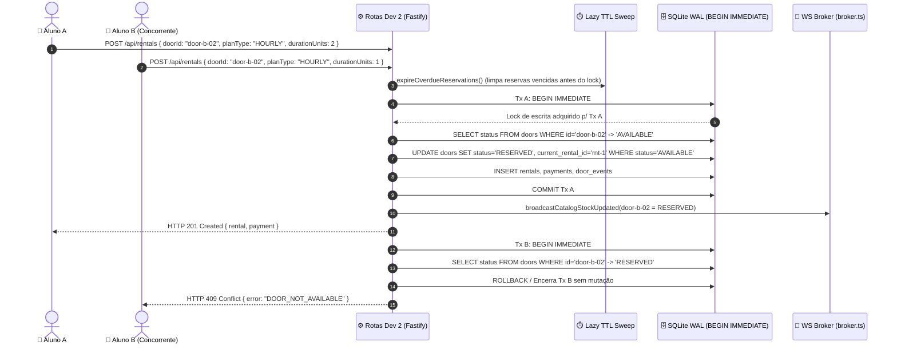

# Documentação Técnica e de Testes — Dev 2 (Backend A: Core Comercial & Persistência)

> **Projeto:** ConectaLab — Plataforma de Empréstimo e Locação de Objetos Universitários via Smart Lockers  
> **Módulo:** Trilha 2 — Dev 2 (Backend A: SQLite WAL, Autenticação Institucional, Catálogo, Reserva Atômica, PIX Mock, Prorrogação, Vistoria Expressa 2m e Worker TTL)  
> **Branch Oficial:** `feat/be1-commercial-core`  
> **Documentos Base:** [`docs/SPEC.md`](./SPEC.md) · [`docs/ADT.md`](./ADT.md) · [`docs/WORKPLAN_3_DEVS.md`](./WORKPLAN_3_DEVS.md)

---

## Sumário

1. [Visão Geral e Matriz de Propriedade (Zero Conflito Git)](#1-visão-geral-e-matriz-de-propriedade-zero-conflito-git)
2. [Matriz de Rastreabilidade de Requisitos do Dev 2](#2-matriz-de-rastreabilidade-de-requisitos-do-dev-2)
3. [Arquitetura Interna, Transações ACID e Fluxo Real-Time](#3-arquitetura-interna-transações-acid-e-fluxo-real-time)
4. [Camada de Persistência SQLite e Segurança (`BE1-01`)](#4-camada-de-persistência-sqlite-e-segurança-be1-01)
5. [Referência Detalhada dos Endpoints REST (`BE1-02` a `BE1-05`)](#5-referência-detalhada-dos-endpoints-rest-be1-02-a-be1-05)
6. [Worker de Expiração Automática TTL (`BE1-06`)](#6-worker-de-expiração-automática-ttl-be1-06)
7. [Guia de Integração com Dev 1 (Frontend) e Dev 3 (Backend IoT)](#7-guia-de-integração-com-dev-1-frontend-e-dev-3-backend-iot)
8. [Documentação da Suíte de Testes Unitários e de Regressão (39 Testes)](#8-documentação-da-suíte-de-testes-unitários-e-de-regressão-39-testes)
9. [Exemplos Práticos de Uso (PowerShell & cURL)](#9-exemplos-práticos-de-uso-powershell--curl)

---

## 1. Visão Geral e Matriz de Propriedade (Zero Conflito Git)

O escopo do **Dev 2 (Backend A)** compreende toda a camada de persistência relacional em **SQLite (`WAL Mode`)**, segurança de sessão/autorização institucional, catálogo de armários/portas, motor transacional de reservas com bloqueio atômico contra concorrência, simulação de webhook bancário PIX, funcionalidades extras comerciais (prorrogação de prazo e vistoria expressa de 2 minutos com estorno automático) e rotina de expiração automática de reservas não pagas (TTL).

Seguindo rigorosamente a Matriz de Isolamento do [`docs/WORKPLAN_3_DEVS.md`](./WORKPLAN_3_DEVS.md), **nenhum arquivo pertencente ao Tech Lead (`src/shared/types.ts`), ao Dev 1 (`src/client/**`) ou ao Dev 3 (`index.ts`, `broker.ts`, `unlock.routes.ts`, `admin.routes.ts`) foi alterado**:

| Arquivo / Diretório | Card | Papel na Arquitetura |
| :--- | :---: | :--- |
| `src/server/db/connection.ts` | `BE1-01` | Singleton `better-sqlite3` em modo `WAL`, `busy_timeout`, `initDatabase()`, `resetDatabaseWithSeeds()`, `runImmediateTransaction()` e auditoria `insertDoorEvent()`. |
| `src/server/db/auth-helper.ts` | `BE1-01` | Assinatura/verificação criptográfica JWT `HS256` (`node:crypto`), validação de domínio institucional e middleware `requireAuthenticatedUser()` com proteção anti-spoofing e anti-IDOR. |
| `src/server/db/schema.sql` | `BE1-01` | DDL completo das 7 tabelas (`users`, `lockers`, `items`, `doors`, `rentals`, `payments`, `door_events`) com `CHECK` constraints e índices de performance. |
| `src/server/db/seeds.sql` | `BE1-01` | Carga inicial de demonstração (2 armários nos Blocos A e B, 6 itens, 6 portas 1:1 e 3 usuários padrão). |
| `src/server/db/reset-cli.ts` | `BE1-01` | Utilitário CLI (`npm run db:reset`) para restauração limpa do banco. |
| `src/server/routes/auth.routes.ts` | `BE1-02` | Endpoint `POST /api/auth/quick-login` com validação institucional, upsert atômico e recuperação de `activeRentalId`. |
| `src/server/routes/lockers.routes.ts` | `BE1-03` | Endpoints `GET /api/lockers` e `GET /api/lockers/:lockerId/catalog` com agregação em tempo real. |
| `src/server/routes/rentals.routes.ts` | `BE1-04` / `BE1-05` | Endpoints `POST /api/rentals`, `GET /api/rentals/:rentalId`, `POST /api/rentals/:rentalId/extend` e `POST /api/rentals/:rentalId/report-issue`. |
| `src/server/routes/payments.routes.ts` | `BE1-05` | Endpoint `POST /api/payments/pix-mock-webhook` para confirmação instantânea do PIX Mock. |
| `src/server/workers/ttl-worker.ts` | `BE1-06` | Worker periódico (`10s`) e função síncrona `expireOverdueReservations()` para cancelamento automático por TTL. |
| `src/server/__tests__/dev2/**` | QA | Infraestrutura de isolamento em banco temporário (`setup-test-db.ts`), spy WebSocket (`ws-test-spy.ts`), **5 suítes unitárias** (34 testes) e **1 suíte de regressão E2E** (5 fluxos completos). |

---

## 2. Matriz de Rastreabilidade de Requisitos do Dev 2

| Requisito | Descrição (`SPEC.md` / `ADT.md`) | Implementação Dev 2 | Cobertura de Testes |
| :--- | :--- | :--- | :--- |
| **`RF01`** | Autenticação Institucional Rápida (`@faculdade.edu.br` / `@aluno.faculdade.edu.br`) | `auth.routes.ts` + `auth-helper.ts` | `unit.auth-routes.test.ts` · `regression.dev2-e2e.test.ts` |
| **`RF02`** | Catálogo por Ponto de Retirada (Bloco/Armário) em tempo real | `lockers.routes.ts` | `unit.lockers-routes.test.ts` · `regression.dev2-e2e.test.ts` |
| **`RF03`** | Seleção de Período (`HOURLY` vs `DAILY`) e cálculo automático em centavos | `rentals.routes.ts` (`POST /api/rentals`) | `unit.rentals-and-payments.test.ts` · `regression.dev2-e2e.test.ts` |
| **`RF04`** | Reserva Antecipada com bloqueio imediato de estoque e TTL de 10 minutos | `rentals.routes.ts` (`POST /api/rentals`) | `unit.rentals-and-payments.test.ts` · `regression.dev2-e2e.test.ts` |
| **`RF05`** | Checkout PIX Simulado (Mock EMV + QR SVG + Webhook de confirmação) | `payments.routes.ts` (`POST /api/payments/pix-mock-webhook`) | `unit.rentals-and-payments.test.ts` · `regression.dev2-e2e.test.ts` |
| **`RF07`** | Painel de Locação Ativa e dados para Cronômetro Regressivo | `rentals.routes.ts` (`GET /api/rentals/:rentalId`) | `unit.rentals-and-payments.test.ts` · `regression.dev2-e2e.test.ts` |
| **`RF09`** | *(Extra)* Prorrogação de Horário (`+1h` / `+1 dia`) com validação de restrições | `rentals.routes.ts` (`POST /api/rentals/:rentalId/extend`) | `unit.rentals-and-payments.test.ts` · `regression.dev2-e2e.test.ts` |
| **`RF10`** | *(Extra)* Vistoria Expressa em `<= 120s` com estorno `REFUNDED`, porta `MAINTENANCE` e abertura automática | `rentals.routes.ts` (`POST /api/rentals/:rentalId/report-issue`) | `unit.rentals-and-payments.test.ts` · `regression.dev2-e2e.test.ts` |
| **`RF14`** | Sincronização automática de estados e auditoria em `door_events` + WebSocket | Todos os módulos de escrita + `insertDoorEvent()` | Todas as suítes unitárias e de regressão |
| **`RF16`** | *(Extra)* Expiração Automática de Reserva por Timeout (TTL) | `ttl-worker.ts` (`expireOverdueReservations` + `startTtlWorker`) | `unit.ttl-worker.test.ts` · `regression.dev2-e2e.test.ts` |
| **`RN01`** | Vínculo estrito `1:1` entre Porta e Item (`UNIQUE(item_id)`) | `schema.sql` + validações em `rentals.routes.ts` | `unit.db-and-auth-helper.test.ts` · `unit.lockers-routes.test.ts` |
| **`RN02`** | Bloqueio atômico contra dupla locação (`BEGIN IMMEDIATE` -> `HTTP 409 Conflict`) | `connection.ts` + `rentals.routes.ts` | `unit.rentals-and-payments.test.ts` · `regression.dev2-e2e.test.ts` (12 clientes simultâneos) |
| **`RN03`** | Transição controlada de pagamento (`PAID` -> `PAID_READY_FOR_PICKUP`) | `payments.routes.ts` | `unit.rentals-and-payments.test.ts` · `regression.dev2-e2e.test.ts` |
| **`RNF04`** | Execução 100% local custo zero em SQLite `WAL` | `connection.ts` (`better-sqlite3@^12.8.0`) | `unit.db-and-auth-helper.test.ts` |
| **`RNF05`** | Segurança de sessão JWT `HS256` e proteção contra IDOR entre usuários | `auth-helper.ts` + `rentals.routes.ts` | `unit.db-and-auth-helper.test.ts` · `regression.dev2-e2e.test.ts` |

---

## 3. Arquitetura Interna, Transações ACID e Fluxo Real-Time

### 3.1. Princípio de Consistência: Transação `IMMEDIATE` Antes, WebSocket Depois
Todas as mutações de estado comercial seguem estritamente um protocolo de **2 fases**:
1. **Fase 1 (Persistência Atômica Síncrona):** Executa leituras de validação e escritas (`UPDATE`/`INSERT`) dentro de `runImmediateTransaction(() => { ... })`, que emite `BEGIN IMMEDIATE` no SQLite. Nenhum outro comando concorrente pode intercalar leituras obsoletas (`AVAILABLE`) antes do `COMMIT`.
2. **Fase 2 (Notificação Real-Time Pós-Commit):** Somente **após** o `COMMIT` ser confirmado em disco (`WAL`), a rota invoca as funções do `broker.ts` (`broadcastCatalogStockUpdated`, `sendRentalStatusUpdated`, `sendDoorUnlockCommand`), garantindo que nenhum cliente WebSocket receba eventos de uma transação revertida (*dirty broadcast*).



---

## 4. Camada de Persistência SQLite e Segurança (`BE1-01`)

### 4.1. Configuração do Banco (`src/server/db/connection.ts`)
Na abertura da conexão `better-sqlite3`, quatro diretivas `PRAGMA` são aplicadas obrigatoriamente:
- `PRAGMA journal_mode = WAL;` — Habilita *Write-Ahead Logging*, permitindo leituras concorrentes de altíssima velocidade enquanto uma transação escreve.
- `PRAGMA synchronous = NORMAL;` — Equilíbrio ideal entre durabilidade em modo WAL e baixa latência (`< 5ms`).
- `PRAGMA foreign_keys = ON;` — Ativa verificação estrita de integridade referencial entre todas as 7 tabelas.
- `PRAGMA busy_timeout = 5000;` — Evita erros imediatos de `SQLITE_BUSY` sob picos de contenção.

#### Variável de Ambiente para Isolamento de Testes
- **`CONECTALAB_DB_PATH`**: Quando definida (ex: por `setup-test-db.ts`), redireciona o arquivo SQLite para um caminho isolado em `os.tmpdir()` (ou `:memory:`). Quando omitida em desenvolvimento/produção, utiliza `data/conectalab.db`.

#### Funções Exportadas por `connection.ts`
- `db`: Instância singleton `Database.Database` (consumida por Dev 2 e Dev 3).
- `DB_FILE_PATH`: Caminho absoluto resolvido do arquivo de banco ativo.
- `initDatabase()`: Aplica `schema.sql` e popula `seeds.sql` automaticamente caso a tabela `lockers` esteja vazia.
- `resetDatabaseWithSeeds()`: Restaura atomicamente (`BEGIN IMMEDIATE`) todas as tabelas para o estado limpo de demonstração e reinicia a sequência `AUTOINCREMENT` de `door_events`.
- `runImmediateTransaction<T>(fn: () => T): T`: Executa `fn` dentro de `db.transaction(fn).immediate()` com rollback automático em caso de exceção.
- `insertDoorEvent(params)`: Insere registros padronizados na tabela de auditoria `door_events`.

---

### 4.2. Autenticação JWT `HS256` e Anti-IDOR (`src/server/db/auth-helper.ts`)
Para atender ao **RNF05** sem adicionar pacotes externos ao `package.json`:
1. **`signAuthToken(user)`**: Gera um token JWT padrão de 3 segmentos (`header.payload.signature` em `base64url`) assinado via `HMAC-SHA256` (`node:crypto`) usando `CONECTALAB_JWT_SECRET` (com fallback local seguro para demonstração).
2. **`verifyAuthToken(token)`**: Valida o formato e compara assinaturas em tempo constante via `crypto.timingSafeEqual` (prevenindo *timing attacks*), retornando `null` caso qualquer caractere do header, payload ou assinatura tenha sido adulterado.
3. **`resolveAuthenticatedUser(request)` / `requireAuthenticatedUser(request, reply)`**:
   - Se o header `Authorization: Bearer <token>` estiver presente: exige assinatura `HS256` válida (`401 INVALID_TOKEN` se inválido).
   - **Proteção Anti-Spoofing:** Se ambos `Authorization: Bearer <token>` e `x-user-id` forem enviados (como faz `src/client/lib/api.ts`), exige que pertençam exatamente ao mesmo `userId`; divergências retornam `401 TOKEN_USER_MISMATCH`.
   - **Compatibilidade de Integração (`ADT.md` Seção 4.1):** Caso apenas `x-user-id` seja enviado em chamadas internas/testes de integração, valida que o usuário existe na tabela `users` (`401 USER_NOT_FOUND` caso inexistente).
   - **Proteção Anti-IDOR nas Rotas de Locação:** Todas as rotas sobre uma locação específica (`GET /api/rentals/:id`, `POST /extend`, `POST /report-issue`) verificam `rental.userId === authUser.id || authUser.role === 'ADMIN'`, bloqueando acessos cruzados entre estudantes com **`HTTP 403 Forbidden` (`FORBIDDEN_RENTAL_ACCESS`)**.

---

## 5. Referência Detalhada dos Endpoints REST (`BE1-02` a `BE1-05`)

### 5.1. `POST /api/auth/quick-login` (`BE1-02` — `RF01`)
Autentica ou cadastra instantaneamente um usuário institucional e informa se há locação ativa em andamento.

- **Autenticação:** Pública
- **Body (`QuickLoginRequest`):**
  ```json
  {
    "name": "Lucas Andrade",
    "ra": "20261045",
    "email": "lucas.andrade@faculdade.edu.br"
  }
  ```
- **Regras Internas:**
  1. Valida `email` contra `/^[a-zA-Z0-9._%+-]+@(?:aluno\.)?faculdade\.edu\.br$/i`.
  2. Valida que `name` e `ra` não estão vazios após `.trim()`.
  3. Executa `expireOverdueReservations()` para limpar eventuais reservas expiradas antes da busca.
  4. Em `runImmediateTransaction`: realiza *Upsert* por `email` normalizado em minúsculas (preservando `id`, `role` e `created_at` de usuários já existentes; novos usuários recebem `role = 'STUDENT'`) e busca a locação ativa mais recente (`AWAITING_PAYMENT` no prazo, `PAID_READY_FOR_PICKUP`, `IN_USE` ou `AWAITING_RETURN_CLOSE`).
- **Respostas:**
  - `200 OK`: `{ token, user: { id, name, ra, email, role, createdAt }, activeRentalId }`
  - `400 Bad Request` (`INVALID_INSTITUTIONAL_EMAIL`): Domínio fora de `@faculdade.edu.br` / `@aluno.faculdade.edu.br`.
  - `400 Bad Request` (`INVALID_LOGIN_INPUT`): `name` ou `ra` ausentes/em branco.

---

### 5.2. `GET /api/lockers` (`BE1-03` — `RF02`, `RF11`)
Lista todos os pontos de armários inteligentes com contadores agregados de disponibilidade em tempo real.

- **Autenticação:** Pública
- **Regras Internas:** Executa `expireOverdueReservations()`, agrega `COUNT(d.id)` (`totalDoorsCount`) e portas `AVAILABLE` (`availableDoorsCount`) mantendo a ordem dos blocos (`ORDER BY l.rowid ASC`) e converte `is_online` para `boolean`.
- **Resposta `200 OK` (`ListLockersResponse`):**
  ```json
  {
    "lockers": [
      {
        "id": "locker-bloco-b",
        "code": "BLOCO-B-01",
        "name": "Armário Bloco B — Laboratórios e Saúde",
        "buildingLocation": "Corredor Principal Térreo (Ao lado do Lab. Química)",
        "isOnline": true,
        "totalDoorsCount": 4,
        "availableDoorsCount": 4
      }
    ]
  }
  ```

---

### 5.3. `GET /api/lockers/:lockerId/catalog` (`BE1-03` — `RF02`, `RF11`, `RF14`, `RN01`)
Retorna os metadados de um armário específico e todas as suas portas numeradas em ordem crescente com objeto vinculado e ocupante atual (quando alugada/reservada).

- **Autenticação:** Pública
- **Respostas:**
  - `200 OK` (`LockerCatalogResponse`): `{ locker, doors: DoorWithItem[] }` ordenado por `doorNumber ASC`, com `requiresPreparation` convertido estritamente para `boolean`.
  - `404 Not Found` (`LOCKER_NOT_FOUND`): Armário inexistente.

---

### 5.4. `POST /api/rentals` (`BE1-04` — `RF03`, `RF04`, `RN01`, `RN02`, `RNF05`)
Reserva atomicamente uma porta disponível, calcula o valor total e gera a cobrança PIX Mock com TTL de 10 minutos.

- **Autenticação:** `Authorization: Bearer <token>` (ou `x-user-id`)
- **Body (`CreateRentalRequest`):**
  ```json
  {
    "doorId": "door-b-02",
    "planType": "HOURLY",
    "durationUnits": 2
  }
  ```
- **Regras Internas:**
  1. Valida autenticação (`401`) e parâmetros (`planType` em `HOURLY | DAILY`, `durationUnits` inteiro `1..30`).
  2. Executa `expireOverdueReservations()`.
  3. Em `runImmediateTransaction`:
     - Verifica existência da porta (`404 DOOR_NOT_FOUND`) e vínculo de item (`409 DOOR_WITHOUT_ITEM`).
     - Verifica `door.status === 'AVAILABLE'` + `UPDATE doors ... WHERE id = ? AND status = 'AVAILABLE'` (`changes === 1`), rejeitando concorrência com `409 DOOR_NOT_AVAILABLE` (**RN02**).
     - Calcula `totalAmountCents`, gera payload EMV `pixCopyPaste` e QR Code vetorial `pixQrSvg`, grava `rentals` (`AWAITING_PAYMENT`, `reservation_expires_at = +10 min`), `payments` (`PENDING`) e `door_events` (`STATUS_CHANGE`).
  4. Pós-commit: emite `CATALOG_STOCK_UPDATED` via WebSocket.
- **Respostas:**
  - `201 Created` (`CreateRentalResponse`): `{ rental, payment }`
  - `400 Bad Request` (`INVALID_RENTAL_INPUT`)
  - `401 Unauthorized`
  - `404 Not Found` (`DOOR_NOT_FOUND`)
  - `409 Conflict` (`DOOR_NOT_AVAILABLE` | `DOOR_WITHOUT_ITEM`)

---

### 5.5. `GET /api/rentals/:rentalId` (`BE1-04` — `RF07`, `RNF05`)
Retorna os detalhes hidratados da locação (dados da porta, bloco, objeto, timestamps do cronômetro regressivo e pagamento PIX).

- **Autenticação:** `Authorization: Bearer <token>` (ou `x-user-id`) — apenas titular da locação ou `ADMIN`.
- **Respostas:**
  - `200 OK` (`GetRentalDetailsResponse`): `{ rental, payment }`
  - `401 Unauthorized`
  - `403 Forbidden` (`FORBIDDEN_RENTAL_ACCESS`)
  - `404 Not Found` (`RENTAL_NOT_FOUND`)

---

### 5.6. `POST /api/payments/pix-mock-webhook` (`BE1-05` — `RF05`, `RN03`)
Simula o webhook bancário de liquidação instantânea do PIX, liberando o destravamento remoto do armário.

- **Autenticação:** Pública (Simulador de Webhook Bancário)
- **Body (`PixMockWebhookRequest`):** `{ "rentalId": "rnt-..." }`
- **Regras Internas:**
  1. Executa `expireOverdueReservations()` (impede pagamento de reserva cujo TTL já expirou).
  2. Em `runImmediateTransaction`: valida `rental.status === 'AWAITING_PAYMENT'`, atualiza `payments.status = 'PAID'`, `rentals.status = 'PAID_READY_FOR_PICKUP'`, `doors.status = 'AWAITING_PICKUP'` e registra `STATUS_CHANGE` em `door_events`.
  3. Pós-commit: emite `CATALOG_STOCK_UPDATED` (broadcast) e `RENTAL_STATUS_UPDATED` (celular do aluno + Admin).
- **Respostas:**
  - `200 OK` (`PixMockWebhookResponse`): `{ success: true, rentalId, rentalStatus: "PAID_READY_FOR_PICKUP", doorStatus: "AWAITING_PICKUP", paidAt, canUnlock: true }`
  - `400 Bad Request` (`INVALID_WEBHOOK_PAYLOAD`)
  - `404 Not Found` (`RENTAL_NOT_FOUND`)
  - `409 Conflict` (`RENTAL_NOT_AWAITING_PAYMENT`)

---

### 5.7. `POST /api/rentals/:rentalId/extend` (`BE1-05` — `RF09`, `RNF05`)
Prorroga o prazo de devolução de uma locação em andamento (`IN_USE`) somando horas ou diárias.

- **Autenticação:** Titular da locação ou `ADMIN`
- **Body (`ExtendRentalRequest`):** `{ "planType": "HOURLY", "additionalUnits": 1 }`
- **Regras Internas:**
  - Exige `rental.status === 'IN_USE'` (`409 RENTAL_NOT_IN_USE` caso contrário).
  - Verifica se a porta não possui bloqueio administrativo (`MAINTENANCE` / `IN_PREPARATION`) ou reserva futura pendente (`409 EXTENSION_RESTRICTED` — Gherkin Cenário 2 do `RF09`).
  - Soma o tempo contratado ao `expected_return_at`, incrementa `rentals.total_amount_cents` e `payments.amount_cents`, grava auditoria em `door_events` e dispara `RENTAL_STATUS_UPDATED` + `CATALOG_STOCK_UPDATED`.
- **Respostas:**
  - `200 OK` (`ExtendRentalResponse`): `{ success: true, rental, addedAmountCents, message }`
  - `400 Bad Request` (`INVALID_EXTEND_INPUT`) · `401 Unauthorized` · `403 Forbidden` · `404 Not Found` · `409 Conflict` (`RENTAL_NOT_IN_USE` | `EXTENSION_RESTRICTED`)

---

### 5.8. `POST /api/rentals/:rentalId/report-issue` (`BE1-05` — `RF10`, `RNF05`)
Registra defeito/avaria na **Vistoria Expressa de 2 minutos** (`120s` contados a partir de `first_unlocked_at`), estornando integralmente o pagamento (`REFUNDED`), bloqueando a porta para `MAINTENANCE` e destravando-a imediatamente para devolução caso já esteja trancada.

- **Autenticação:** Titular da locação ou `ADMIN`
- **Body (`ReportIssueRequest`):** `{ "issueNotes": "Calculadora sem pilha / display apagado" }`
- **Regras Internas:**
  1. Verifica titularidade (`403`), locação ainda aberta (`409 RENTAL_ALREADY_CLOSED` se já encerrada) e abertura inicial realizada (`400 RENTAL_NOT_UNLOCKED_YET` se `first_unlocked_at` for nulo).
  2. **Janela Estrita de 120s:** Se `Date.now() - Date.parse(first_unlocked_at) > 120_000`, rejeita com **`HTTP 400 Bad Request` (`INSPECTION_WINDOW_EXPIRED`)**.
  3. Em `runImmediateTransaction`: muda `rentals` (`CANCELLED`, `cancel_reason = 'ISSUE_REPORTED'`, `issue_notes`), `payments` (`REFUNDED`), `doors` (`status = 'MAINTENANCE'`, `lock_state = 'UNLOCKED'`, `current_rental_id = NULL`) e grava `door_events`.
  4. Pós-commit: se a porta estava `LOCKED`, dispara `sendDoorUnlockCommand` (`actionContext: 'RETURN'`, `playSoundEffect: true`) para o Simulador abrir a porta imediatamente; emite `CATALOG_STOCK_UPDATED` e `RENTAL_STATUS_UPDATED`.
- **Respostas:**
  - `200 OK` (`ReportIssueResponse`): `{ success: true, rentalId, rentalStatus: "CANCELLED", paymentStatus: "REFUNDED", doorStatus: "MAINTENANCE", message }`
  - `400 Bad Request` (`INVALID_ISSUE_NOTES` | `RENTAL_NOT_UNLOCKED_YET` | `INSPECTION_WINDOW_EXPIRED`) · `401` · `403` · `404` · `409` (`RENTAL_ALREADY_CLOSED`)

---

## 6. Worker de Expiração Automática TTL (`BE1-06`)

Implementado em `src/server/workers/ttl-worker.ts`, atua em **dupla camada** para garantir precisão absoluta de estoque:

1. **Varredura Ativa em Background (`startTtlWorker(10_000)`):**
   - Iniciada pelo servidor em `src/server/index.ts`, executa `expireOverdueReservations()` a cada **10 segundos**.
   - O timer utiliza `workerTimer.unref()` para nunca travar o encerramento gracioso do processo Node.js, e pode ser encerrado explicitamente via `stopTtlWorker()`.
2. **Varredura *Lazy* Sob Demanda:**
   - Invocada sincronicamente no início de `/api/auth/quick-login`, `/api/lockers`, `/api/lockers/:id/catalog`, `POST /api/rentals`, `GET /api/rentals/:id` e `POST /api/payments/pix-mock-webhook` (além da rota administrativa `POST /api/admin/maintenance/expire-ttl`).
   - Consulta indexada via `idx_rentals_ttl (status, reservation_expires_at)`, garantindo que uma reserva vencida há `1ms` nunca bloqueie outro estudante nem aceite PIX atrasado antes do próximo ciclo de 10 segundos.

---

## 7. Guia de Integração com Dev 1 (Frontend) e Dev 3 (Backend IoT)

### 7.1. Integração com Dev 1 (`src/client/lib/api.ts`)
Para conectar o Frontend React às rotas reais do Dev 2 (desligando o mock em `localStorage`):
- No console do navegador (ou botão de alternância de ambiente da UI):
  ```js
  localStorage.setItem('CONECTALAB_USE_MOCK', 'false');
  location.reload();
  ```
- Todos os payloads JSON, códigos HTTP e eventos WebSocket (`CATALOG_STOCK_UPDATED` e `RENTAL_STATUS_UPDATED`) seguem 100% os tipos congelados em `src/shared/types.ts`.

### 7.2. Integração com Dev 3 (`unlock.routes.ts`, `admin.routes.ts`, `broker.ts`)
O Dev 3 dispõe dos seguintes utilitários prontos e testados exportados pelo Dev 2:
- De `src/server/db/connection.ts`: `db`, `runImmediateTransaction`, `insertDoorEvent`, `initDatabase`, `resetDatabaseWithSeeds`.
- De `src/server/db/auth-helper.ts`: `requireAuthenticatedUser`, `resolveAuthenticatedUser`, `verifyAuthToken` (pronto para autenticar `/unlock` e `/return-unlock` caso o Dev 3 deseje reutilizar!).
- De `src/server/workers/ttl-worker.ts`: `expireOverdueReservations`, `startTtlWorker`, `stopTtlWorker`.

---

## 8. Documentação da Suíte de Testes Unitários e de Regressão (39 Testes)

### 8.1. Isolamento Total de Banco e Rede
- **`setup-test-db.ts`**: Importado na primeira linha de cada arquivo `.test.ts`, provisiona um arquivo SQLite exclusivo por processo em `os.tmpdir()/conectalab-dev2-tests/` em modo `WAL` real e remove os arquivos `.db`, `.db-wal` e `.db-shm` ao término da suíte (`cleanupTestDb`). O banco local `data/conectalab.db` **jamais é modificado** pela execução de testes.
- **`ws-test-spy.ts`**: Registra clientes WebSocket simulados diretamente em `registerWsConnection` do `broker.ts` (e no teste de regressão E2E conecta também um cliente `ws` real sobre TCP `ws://127.0.0.1`), validando todos os envelopes emitidos sem alterar uma única linha do código do Dev 3.

### 8.2. Comandos de Execução

```powershell
# Executar todas as 6 suítes (39 testes: 34 unitários + 5 de regressão E2E)
npm test

# Executar apenas os 34 testes unitários isolados por card
npm run test:unit

# Executar apenas os 5 fluxos de regressão ponta a ponta e concorrência
npm run test:regression

# Validar tipagem estrita TypeScript em todo o projeto
npm run typecheck
```

### 8.3. Catálogo dos 39 Cenários Automatizados

| Suíte | Qtd | Cenários Validados |
| :--- | :---: | :--- |
| **`unit.db-and-auth-helper.test.ts`** (`BE1-01`) | **8** | Isolamento `CONECTALAB_DB_PATH` + `WAL` + `foreign_keys = ON`; carga de seeds (2 armários, 6 itens, 6 portas, 3 usuários); constraint `UNIQUE` 1:1 porta-item (`RN01`); constraints `CHECK` de estados; rollback atômico em `runImmediateTransaction`; sequência e reset de `door_events`; regex institucional (`RF01`); assinatura/adulteração JWT `HS256` e bloqueio de spoofing `Bearer` vs `x-user-id` (`RNF05`). |
| **`unit.auth-routes.test.ts`** (`BE1-02`) | **6** | Login de aluno seed (`< 50ms`) preservando `id`/`role`; cadastro automático (upsert) normalizando espaços/maiúsculas em `@aluno.faculdade.edu.br`; preservação de `role = 'ADMIN'`; rejeição `400 INVALID_INSTITUTIONAL_EMAIL` para 10 formatos inválidos/maliciosos; rejeição `400 INVALID_LOGIN_INPUT`; resolução exata de `activeRentalId` entre locações vigentes, expiradas, concluídas e de outros alunos. |
| **`unit.lockers-routes.test.ts`** (`BE1-03`) | **6** | Listagem ordenada dos armários com contadores exatos e `isOnline` booleano; decremento progressivo de `availableDoorsCount` em `RESERVED`, `OCCUPIED_RENTED`, `IN_PREPARATION` e `MAINTENANCE`; ordenação `doorNumber ASC` `[1..4]`, preços em centavos e `requiresPreparation` booleano (`RF17`); ocupante atual (`currentOccupantName`, `currentOccupantRa`, `expectedReturnAt`); resiliência com `item_id = NULL`; erro `404 LOCKER_NOT_FOUND`. |
| **`unit.rentals-and-payments.test.ts`** (`BE1-04` & `BE1-05`) | **8** | Reserva `HOURLY` (centavos, TTL 10m, EMV PIX, SVG QR e WS broadcast); cálculo `DAILY`; bloqueio concorrente `409 DOOR_NOT_AVAILABLE` (`RN02`); webhook PIX Mock (`200` + idempotência `409` + eventos WS); consulta `GET /api/rentals/:id` pelo titular (`200`) vs bloqueio anti-IDOR (`403`); prorrogação `/extend` (`+2h`, soma financeira e bloqueio `409 EXTENSION_RESTRICTED`); vistoria `/report-issue` em `<= 120s` (porta trancada dispara `DOOR_UNLOCK_COMMAND`, porta aberta não duplica comando, estorno `REFUNDED` e `MAINTENANCE`), antes do unlock (`400 RENTAL_NOT_UNLOCKED_YET`), após `> 120s` (`400 INSPECTION_WINDOW_EXPIRED`) e já encerrada (`409`); entradas inválidas e recursos `404`/`409`. |
| **`unit.ttl-worker.test.ts`** (`BE1-06`) | **6** | Retorno `0` sem eventos quando não há vencimentos; expiração atômica completa (`CANCELLED` + `EXPIRED_TTL` + `EXPIRED` + porta `AVAILABLE` + `door_events` + WS seletivo); preservação de reservas futuras; preservação de locações `PAID_READY_FOR_PICKUP` e `IN_USE`; idempotência sem duplicar logs/WS; ciclo automático em background `startTtlWorker(40)` / `stopTtlWorker()`. |
| **`regression.dev2-e2e.test.ts`** (Regressão Integrada) | **5** | **1.** Jornada completa Gherkin (`RF01 -> RF02 -> RF03 -> RF04 -> RF05 -> RF07 -> RF09`) com cliente WebSocket TCP real conectado em `/ws`; **2.** Rajada `Promise.all` de **12 estudantes simultâneos** disputando a mesma porta comprovando `1x 201` e `11x 409` (`RN02`); **3.** Expiração TTL via rota Admin + bloqueio de webhook PIX tardio + re-locação imediata por outra aluna; **4.** Fluxo E2E de Vistoria Expressa com estorno, abertura física e bloqueio contra novas locações; **5.** Matriz de segurança `RNF05` (`401`, JWT forjado, `403` em todas as rotas de mutação/leitura, suporte `ADMIN` `200`) + restauração global via `POST /api/admin/demo/reset`. |

---

## 9. Exemplos Práticos de Uso (PowerShell & cURL)

Com o servidor rodando localmente (`npm run dev:server` na porta `3000`):

```powershell
# 1. Login Institucional Rápido (RF01)
$login = Invoke-RestMethod -Method Post -Uri "http://localhost:3000/api/auth/quick-login" `
  -ContentType "application/json" `
  -Body '{"name":"Lucas Andrade","ra":"20261045","email":"lucas.andrade@faculdade.edu.br"}'

$headers = @{ Authorization = "Bearer $($login.token)" }

# 2. Consultar Catálogo do Bloco B (RF02)
Invoke-RestMethod -Method Get -Uri "http://localhost:3000/api/lockers/locker-bloco-b/catalog"

# 3. Reservar Porta #02 (Jaleco por 2 horas = R$ 8,00) (RF03, RF04, RN02)
$reserva = Invoke-RestMethod -Method Post -Uri "http://localhost:3000/api/rentals" `
  -Headers $headers -ContentType "application/json" `
  -Body '{"doorId":"door-b-02","planType":"HOURLY","durationUnits":2}'

# 4. Simular Aprovação do Banco no Checkout PIX (RF05)
Invoke-RestMethod -Method Post -Uri "http://localhost:3000/api/payments/pix-mock-webhook" `
  -ContentType "application/json" `
  -Body "{`"rentalId`":`"$($reserva.rental.id)`"}"

# 5. Consultar Painel da Locação Ativa (RF07)
Invoke-RestMethod -Method Get -Uri "http://localhost:3000/api/rentals/$($reserva.rental.id)" `
  -Headers $headers
```
