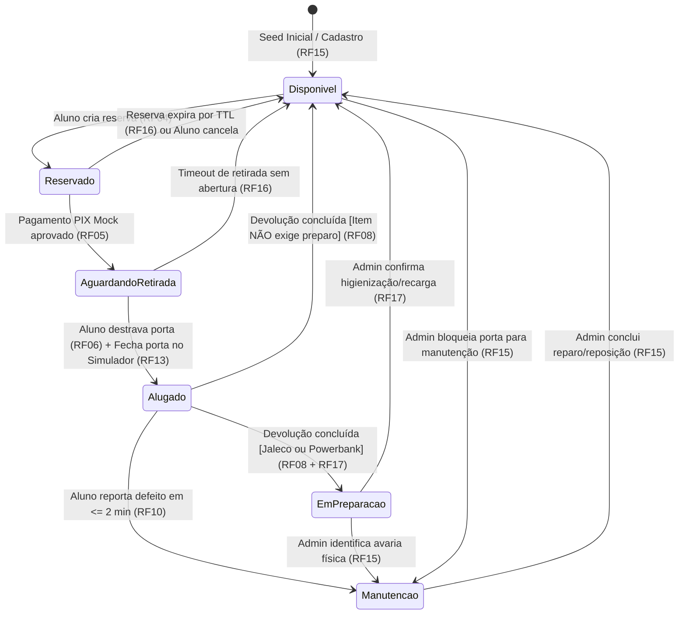
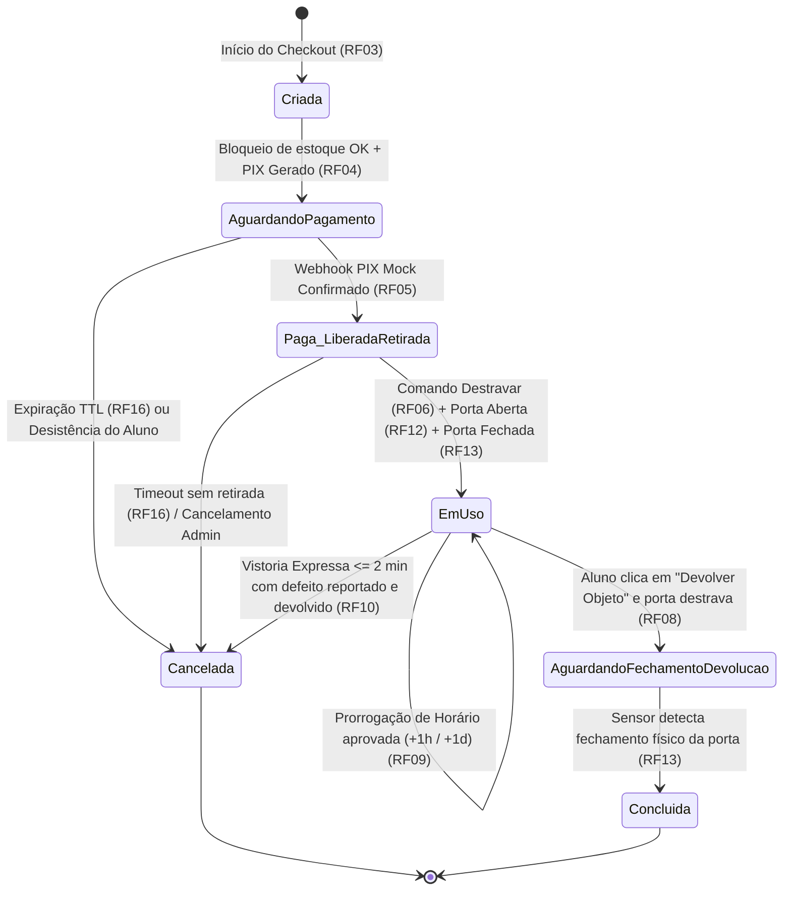

# Especificação Funcional e de Produto (SPEC) — ConectaLab

> **Projeto:** ConectaLab — Plataforma de Empréstimo e Locação de Objetos Universitários via Armários Inteligentes (Smart Lockers)  
> **Versão:** 1.0.0  
> **Status:** Aprovado para Implementação (Baseline de Engenharia)  
> **Autores:** Arquitetura de Software & Gestão de Produto — Grupo ConectaLab

---

## 1. Visão Geral do Produto e Personas

### 1.1. Contexto e Declaração do Problema
No cotidiano universitário, estudantes frequentemente enfrentam imprevistos que comprometem seu desempenho acadêmico: esquecer equipamentos obrigatórios para aulas práticas de laboratório ou avaliações (como **jalecos** e **calculadoras científicas**) ou ficar sem bateria no celular e notebook no meio do turno letivo (demandando **powerbanks** e **carregadores**).

Atualmente, quando um estudante passa por essa situação, ele enfrenta barreiras críticas:
1. **Impedimento acadêmico:** Proibição de entrar em laboratórios sem EPI (jaleco) ou perda de tempo precioso em provas de exatas sem calculadora.
2. **Atrito logístico e burocrático:** Empréstimos informais na secretaria (quando existem) exigem filas, preenchimento de fichas em papel, retenção de documento físico e ficam distantes dos blocos de aula.
3. **Insegurança de disponibilidade:** O aluno desloca-se até um ponto de atendimento sem saber se ainda há unidades disponíveis.
4. **Custo desproporcional:** Comprar um equipamento novo de última hora nos arredores do campus apenas para uso pontual representa um custo elevado.

### 1.2. A Solução ConectaLab (Value Proposition Canvas)
O **ConectaLab** é uma plataforma Web Mobile-First integrada a uma rede de **Armários Inteligentes (Smart Lockers)** distribuídos estrategicamente nos blocos da faculdade. Pelo celular, o estudante consulta a disponibilidade em tempo real no bloco mais próximo, reserva o item por hora ou por dia, realiza o pagamento instantâneo via PIX e destrava a porta do armário remotamente em menos de 1 minuto, sem filas e sem interação humana.

| Dimensão do Canvas | Detalhamento |
| :--- | :--- |
| **Tarefas do Cliente (Customer Jobs)** | Assistir às aulas práticas de laboratório; realizar provas de ciências exatas; manter dispositivos eletrônicos (celular/notebook) carregados durante todo o dia no campus. |
| **Dores (Pains)** | Esquecer jaleco ou calculadora em casa; ficar sem bateria longe de tomadas; perder aula prática por falta de EPI; enfrentar filas ou cadastros lentos; caminhar até outro bloco e descobrir que o item acabou; alto custo de aquisição para uso eventual. |
| **Ganhos (Gains)** | Resolver o imprevisto em menos de 2 minutos no próprio bloco de aula; pagar apenas pelo tempo de uso (hora/dia); ter certeza de que o objeto está reservado e higienizado/carregado; autonomia 100% digital pelo smartphone. |
| **Produtos e Serviços** | Web App Mobile-First (`/app`), Rede de Armários Inteligentes Automatizados por Bloco (`/locker`) e Backoffice de Gestão de Operações (`/admin`). |
| **Analgésicos (Pain Relievers)** | Cadastro expresso (< 1 min) via e-mail institucional; bloqueio imediato de estoque via reserva antecipada; visualização de disponibilidade em tempo real por bloco; destravamento remoto instantâneo (< 500ms) pós-pagamento. |
| **Criadores de Ganho (Gain Creators)** | Tarifação flexível (por hora ou diária); checkout PIX instantâneo; vistoria expressa com cancelamento gratuito em caso de avaria; devolução autônoma 24/7 no próprio armário. |

### 1.3. Catálogo Inicial de Objetos (MVP)
Para o lançamento e validação acadêmica, o catálogo contempla as 4 categorias de maior recorrência no campus:

| Código SKU | Objeto | Categoria | Preço / Hora | Preço / Dia (Diária) | Requer Preparação Pós-Uso? (RF17) |
| :--- | :--- | :--- | :---: | :---: | :---: |
| `CALC-CASIO-FX` | Calculadora Científica (Casio fx-82MS) | Exatas / Provas | R$ 2,00 | R$ 8,00 | Não (Disponível imediatamente) |
| `JALECO-M-LAB` | Jaleco Manga Longa Branco (Tam. M/G) | Saúde / Química | R$ 4,00 | R$ 12,00 | Sim (Higienização / Lavanderia) |
| `PWR-BANK-10K` | Powerbank 10.000mAh (Cabo Integrado) | Energia / Mobile | R$ 3,00 | R$ 10,00 | Sim (Recarga de Bateria 100%) |
| `CHARGER-USBC-65W`| Carregador Rápido USB-C 65W (Note/Cel) | Energia / Notebook | R$ 3,00 | R$ 10,00 | Não (Disponível imediatamente) |

---

### 1.4. Personas e Atores do Sistema

#### Persona 1: Lucas Andrade — Aluno Universitário (Usuário Primário)
- **Perfil:** 20 anos, estudante do 4º semestre de Engenharia Química. Passa o dia inteiro no campus entre aulas teóricas no Bloco A e laboratórios no Bloco B.
- **Comportamento Digital:** Usa smartphone Android/iOS constantemente, prefere Web Apps rápidos que não exigem download pesado na loja de aplicativos, paga tudo via PIX.
- **Cenário Típico:** Chegou ao Bloco B às 18h50 para uma aula prática às 19h00 e percebeu que esqueceu o jaleco em casa. Precisa alugar e retirar um jaleco no corredor do Bloco B em menos de 3 minutos.
- **Objetivos no Sistema:** Entrar com seu e-mail `@faculdade.edu.br`, localizar o armário à sua frente, pagar com PIX e ouvir o "clique" da porta abrindo imediatamente.

#### Persona 2: Mariana Costa — Operadora / Admin do Campus (Backoffice)
- **Perfil:** 26 anos, monitora de operações do ConectaLab no campus.
- **Responsabilidades:** Monitorar o estado das portas dos armários, recolher jalecos devolvidos para higienização, colocar powerbanks para recarregar, repor itens nas portas e prestar suporte de contingência caso um aluno tenha problemas técnicos na abertura.
- **Objetivos no Sistema:** Visualizar rapidamente quais portas estão `Alugadas`, `Disponíveis` ou `Em Preparação`, liberar itens recarregados/higienizados com 1 clique e acionar o botão **Destravar Porta (Master)** remotamente em situações de manutenção ou contingência.

#### Ator Sistêmico 3: Armário Inteligente IoT / Simulador Digital Twin (`Locker Node`)
- **Perfil Técnico:** Aplicação Web interativa executada em tela cheia no PC/Projetor da sala de apresentação (`/locker`), atuando como o **Gêmeo Digital (Digital Twin)** do hardware físico do armário inteligente e seus controladores de fechadura solenoide e sensores reed switch (sensor magnético de estado de porta).
- **Responsabilidades no Sistema:**
  1. Manter conexão persistente e bidirecional via **WebSocket** com o Backend.
  2. Exibir em tempo real o estado físico de cada porta numerada (`TRANCADO` em vermelho vs. `ABERTO` em verde).
  3. Reagir em **< 500ms** ao comando `DOOR_UNLOCK_COMMAND`, alterando a interface visual da porta especificada e executando efeito sonoro mecânico de destravamento da trava solenoide.
  4. Disponibilizar ao apresentador/usuário o botão físico simulado **"Simular Fechamento Físico da Porta"**, emitindo o evento `DOOR_CLOSED_EVENT` ao servidor para concluir os fluxos de retirada e devolução.

---

## 2. Regras de Negócio (RN) e Requisitos Não Funcionais (RNF)

### 2.1. Regras de Negócio (RN)
| ID | Regra de Negócio | Descrição Detalhada e Impacto Sistêmico |
| :--- | :--- | :--- |
| **RN01** | **Vínculo 1:1 entre Porta e Item (MVP)** | Cada porta física numerada de um armário comporta e está vinculada a exatamente **1 (um) objeto específico** por vez. Não há portas compartilhadas por múltiplos itens no MVP. |
| **RN02** | **Bloqueio Atômico contra Dupla Locação** | Assim que um item entra no estado `Reservado` (aguardando pagamento PIX) ou `Alugado`, ele fica imediatamente bloqueado para qualquer outro estudante. Tentativas concorrentes de reserva para a mesma porta devem ser rejeitadas atomicamente pelo banco de dados com erro HTTP `409 Conflict`. |
| **RN03** | **Condição Estrita de Destravamento para Retirada** | O comando remoto de abertura da porta para retirada só pode ser executado se: (a) a locação pertencer ao usuário autenticado; (b) o pagamento PIX Mock estiver confirmado (`PAID`); e (c) a locação estiver dentro da janela vigente no status `Paga_LiberadaRetirada` (ou `EmUso` caso a primeira abertura tenha falhado antes da retirada). |
| **RN04** | **Devolução Vinculada à Porta de Origem** | Durante todo o período em que o objeto está em posse do aluno (`EmUso`), a porta de origem permanece reservada e vinculada exclusivamente àquela locação (`Alugado`), garantindo que o estudante tenha onde devolver o objeto ao término do uso. |

### 2.2. Requisitos Não Funcionais (RNF)
| ID | Categoria | Especificação Técnica e Métrica de Aceite |
| :--- | :--- | :--- |
| **RNF01** | **Latência Real-Time** | O tempo decorrido entre o clique no botão "Destravar Armário" no celular do aluno e a mudança visual/sonora na tela do Simulador do Armário (Projetor) deve ser **inferior a 500ms** via WebSockets. |
| **RNF02** | **Conectividade em Apresentação** | O sistema deve operar sobre um único ponto de entrada HTTP/WebSocket para ser exposto via **Cloudflare Tunnel (`cloudflared`)** ou **ngrok** sobre HTTPS/WSS, permitindo que celulares na rede 4G/5G interajam com o servidor local sem bloqueios de *AP Isolation* do Wi-Fi da faculdade. |
| **RNF03** | **Portabilidade Mobile-First** | O módulo do aluno (`/app`) deve ser uma Web App responsiva (Mobile-First / PWA-ready) compatível com Safari (iOS) e Chrome (Android), sem exigir instalação de pacote APK/IPA. |
| **RNF04** | **Infraestrutura Custo Zero** | Todo o ecossistema (Frontend, Backend, WebSocket Server e Banco de Dados **SQLite**) deve executar localmente no notebook da apresentação sem dependência de serviços pagos em nuvem. |
| **RNF05** | **Segurança e Autorização** | O backend deve validar o token/sessão do estudante e a propriedade da locação em todas as rotas de comando físico (`/unlock`, `/return-unlock`), impedindo *Insecure Direct Object Reference (IDOR)* entre portas e usuários. |
| **RNF06** | **Usabilidade (Regra dos 4 Cliques)** | O fluxo crítico do aluno (1. Selecionar Item/Período -> 2. Confirmar Reserva -> 3. Simular PIX -> 4. Destravar Armário) deve ser concluído em **no máximo 4 telas/ações principais**. |

---

## 3. Detalhamento de User Stories e Critérios de Aceite (Gherkin)

Abaixo estão especificados todos os Requisitos Funcionais (**RF01 a RF17**), divididos por módulo e classificados entre **MVP** (obrigatórios para a demonstração principal) e **Extra** (diferenciais competitivos do produto).

---

### 3.1. Módulo do Aluno (Mobile Web — `/app`)

#### RF01 [MVP] — Autenticação Institucional Rápida
> **User Story:**  
> **Como** um aluno universitário com pressa antes da aula,  
> **Quero** realizar meu login ou cadastro em menos de 1 minuto utilizando apenas meu nome, RA e e-mail institucional,  
> **Para que** eu possa acessar o catálogo e alugar um objeto imediatamente sem burocracia.

**Critérios de Aceite (Gherkin):**
```gherkin
Funcionalidade: RF01 - Autenticação Institucional Rápida

  Cenário: Login ou cadastro expresso com e-mail institucional válido (Sucesso)
    Dado que o aluno acessa a tela inicial "/app/login" pelo navegador do celular
    Quando ele preenche o nome "Lucas Andrade", RA "20261045" e o e-mail "lucas.andrade@faculdade.edu.br"
    E clica no botão "Entrar Instantaneamente"
    Então o sistema valida que o domínio pertence à instituição ("@faculdade.edu.br" ou "@aluno.faculdade.edu.br")
    E cria ou recupera o registro do aluno em menos de 1 segundo
    E armazena o token de sessão no navegador
    E redireciona o aluno diretamente para a tela de Catálogo "/app/catalog"

  Cenário: Tentativa de acesso com domínio de e-mail pessoal não institucional (Erro)
    Dado que o aluno está na tela "/app/login"
    Quando ele informa o e-mail "lucas.andrade@gmail.com"
    E clica no botão "Entrar Instantaneamente"
    Então o sistema bloqueia o envio com status HTTP 400
    E exibe a mensagem de alerta "Use seu e-mail institucional (@faculdade.edu.br) para acessar os armários do campus."
```

---

#### RF02 [MVP] — Catálogo por Ponto de Retirada (Bloco/Armário)
> **User Story:**  
> **Como** um aluno posicionado em um bloco específico do campus,  
> **Quero** filtrar os objetos disponíveis por Bloco/Armário e visualizar o status de cada porta em tempo real,  
> **Para que** eu tenha certeza de que o item que preciso está disponível no armário próximo à minha sala.

**Critérios de Aceite (Gherkin):**
```gherkin
Funcionalidade: RF02 - Catálogo por Ponto de Retirada em Tempo Real

  Cenário: Visualização de itens filtrados por Bloco/Armário (Sucesso)
    Dado que o aluno autenticado acessa a tela "/app/catalog"
    Quando ele seleciona o filtro "Bloco B - Laboratórios (Térreo)"
    Então o sistema lista todos os objetos vinculados às portas daquele armário
    E exibe para cada objeto o nome, categoria, número da porta, valor por hora, valor por dia e badge de disponibilidade ("Disponível", "Reservado", "Em Uso" ou "Em Preparação")

  Cenário: Atualização em tempo real do catálogo quando outro aluno reserva um item (Real-Time)
    Dado que o Aluno A e o Aluno B estão visualizando simultaneamente o catálogo do "Bloco A"
    E a "Porta 01 - Calculadora Científica" está com status "Disponível"
    Quando o Aluno A conclui a reserva da "Porta 01"
    Então a tela do Aluno B recebe um evento WebSocket em tempo real
    E o card da "Porta 01" na tela do Aluno B muda imediatamente para "Reservado" com o botão de seleção desabilitado
```

---

#### RF03 [MVP] — Seleção de Período de Aluguel e Cálculo Automático
> **User Story:**  
> **Como** um aluno que precisa de um item por apenas uma aula ou pelo dia inteiro,  
> **Quero** escolher entre a modalidade de aluguel "Por Hora" ou "Por Dia (Diária)" e ver o valor calculado automaticamente,  
> **Para que** eu pague um preço justo proporcional à minha necessidade.

**Critérios de Aceite (Gherkin):**
```gherkin
Funcionalidade: RF03 - Seleção de Período de Aluguel e Precificação

  Cenário: Seleção de aluguel por hora com cálculo dinâmico (Sucesso)
    Dado que o aluno selecionou o item "Jaleco Manga Longa (Porta 02)" cujo valor é R$ 4,00/hora ou R$ 12,00/dia
    Quando ele escolhe a modalidade "Por Hora" e define a quantidade de "2 horas"
    Então o sistema exibe imediatamente o valor total de "R$ 8,00"
    E calcula a previsão de devolução para "+2 horas" a partir do momento atual

  Cenário: Seleção de aluguel por diária (Sucesso)
    Dado que o aluno selecionou o item "Jaleco Manga Longa (Porta 02)"
    Quando ele alterna a modalidade para "Diária (24h)"
    Então o sistema atualiza o valor total exibido para "R$ 12,00"
    E define o prazo da locação para 24 horas
```

---

#### RF04 [MVP] — Reserva Antecipada com Bloqueio Imediato de Estoque
> **User Story:**  
> **Como** um aluno que encontrou um item disponível no catálogo,  
> **Quero** reservar o objeto imediatamente antes de realizar o pagamento PIX,  
> **Para que** nenhum outro estudante alugue a mesma porta enquanto eu concluo o pagamento.

**Critérios de Aceite (Gherkin):**
```gherkin
Funcionalidade: RF04 - Reserva Antecipada e Bloqueio de Concorrência (RN02)

  Cenário: Criação de reserva de item disponível (Sucesso)
    Dado que a "Porta 03 - Powerbank 10.000mAh" está com status "Disponível"
    Quando o aluno escolhe o período de "1 hora" e clica em "Reservar e Ir para PIX"
    Então o sistema altera atomicamente o estado da "Porta 03" para "Reservado"
    E cria uma locação com status "AguardandoPagamento" e um prazo de expiração (TTL de 10 minutos)
    E redireciona o aluno para a tela de Checkout PIX "/app/checkout/:rentalId"

  Cenário: Tentativa concorrente de reservar um item que acabou de ser reservado (Erro - RN02)
    Dado que a "Porta 03" acabou de mudar para o estado "Reservado" para o Aluno A
    Quando o Aluno B envia uma requisição de reserva para a mesma "Porta 03"
    Então o backend rejeita a transação com código HTTP 409 (Conflict)
    E exibe ao Aluno B a mensagem "Ops! Este objeto acabou de ser reservado por outro colega. Escolha outra porta disponível."
```

---

#### RF05 [MVP] — Checkout PIX Simulado (Mock)
> **User Story:**  
> **Como** um aluno na etapa de pagamento (e avaliador durante a demonstração acadêmica),  
> **Quero** visualizar o QR Code PIX, o código "Copia e Cola" e um botão de "Simular Confirmação do Banco",  
> **Para que** o pagamento seja aprovado instantaneamente via webhook interno simulado sem depender de transações bancárias reais.

**Critérios de Aceite (Gherkin):**
```gherkin
Funcionalidade: RF05 - Checkout PIX Simulado (Mock)

  Cenário: Simulação de aprovação de pagamento PIX com sucesso (Sucesso)
    Dado que o aluno possui uma locação no estado "AguardandoPagamento" na tela "/app/checkout/:rentalId"
    E a tela exibe o QR Code PIX, o código Copia e Cola e o valor total da locação
    Quando o aluno clica no botão "Simular Confirmação do Banco (PIX Pago)"
    Então o sistema aciona o webhook interno de confirmação de pagamento
    E atualiza o status do pagamento para "PAID" com timestamp de confirmação
    E altera o estado da locação para "Paga_LiberadaRetirada"
    E altera o estado da porta para "AguardandoRetirada"
    E redireciona automaticamente o aluno para a tela de Comando de Retirada "/app/rental/:rentalId"
```

---

#### RF06 [MVP] — Comando Remoto de Retirada (Destravar Armário)
> **User Story:**  
> **Como** um aluno em frente ao armário inteligente com pagamento confirmado,  
> **Quero** clicar no botão "Destravar Armário" no meu celular,  
> **Para que** a porta correspondente se abra instantaneamente para eu retirar meu objeto.

**Critérios de Aceite (Gherkin):**
```gherkin
Funcionalidade: RF06 - Comando Remoto de Retirada pelo Celular

  Cenário: Destravamento remoto após pagamento confirmado (Sucesso - RN03 / RNF01)
    Dado que o aluno está na tela "/app/rental/:rentalId" com locação em status "Paga_LiberadaRetirada"
    E o Simulador do Armário está conectado via WebSocket exibindo a "Porta 02" como "TRANCADO"
    Quando o aluno clica no botão "Destravar Armário (Porta 02)"
    Então o backend valida que o aluno é o titular da locação e que o pagamento está confirmado
    E envia o comando WebSocket "DOOR_UNLOCK_COMMAND" para o Simulador do Armário em menos de 500ms
    E o celular do aluno exibe a instrução "Porta 02 Destravada! Retire seu objeto e feche a porta para iniciar o uso."

  Cenário: Tentativa de destravar armário via API sem pagamento confirmado (Erro - RN03 / RNF05)
    Dado que uma locação ainda está com status "AguardandoPagamento"
    Quando uma requisição "POST /api/rentals/:id/unlock" é enviada diretamente para o backend
    Então o backend bloqueia a operação com status HTTP 403 (Forbidden)
    E não emite nenhum comando WebSocket para o armário
    E registra a tentativa negada nos logs de segurança
```

---

#### RF07 [MVP] — Painel de Locação Ativa e Cronômetro Regressivo
> **User Story:**  
> **Como** um aluno utilizando um objeto alugado,  
> **Quero** visualizar um painel com os dados do item, armário/porta de origem e um cronômetro regressivo em tempo real,  
> **Para que** eu controle meu tempo de uso e saiba exatamente onde e quando devolver o objeto.

**Critérios de Aceite (Gherkin):**
```gherkin
Funcionalidade: RF07 - Painel de Locação Ativa

  Cenário: Início da contagem do tempo após retirada e fechamento da porta (Sucesso)
    Dado que o aluno destravou a "Porta 02" para retirada do "Jaleco Manga Longa"
    Quando o sensor da porta (Simulador) confirma o fechamento físico da porta ("DOOR_CLOSED_EVENT")
    Então o estado da locação muda para "EmUso"
    E o painel no celular do aluno exibe o status "Locação em Andamento"
    E apresenta o Bloco/Armário, o número da "Porta 02", o horário limite de devolução e o cronômetro regressivo (HH:MM:SS)
    E habilita o botão "Devolver Objeto"
```

---

#### RF08 [MVP] — Fluxo de Devolução Autônoma
> **User Story:**  
> **Como** um aluno que terminou de utilizar o objeto alugado,  
> **Quero** clicar em "Devolver Objeto" no celular para destravar a porta de origem, guardar o item e encerrar meu contrato,  
> **Para que** minha locação seja finalizada imediatamente sem depender de atendentes.

**Critérios de Aceite (Gherkin):**
```gherkin
Funcionalidade: RF08 - Fluxo de Devolução na Porta de Origem (RN04)

  Cenário: Abertura da porta para devolução e encerramento após fechamento (Sucesso)
    Dado que o aluno possui uma locação ativa ("EmUso") vinculada à "Porta 01 - Calculadora Científica"
    Quando o aluno clica no botão "Devolver Objeto" no celular
    Então o backend altera o estado da locação para "AguardandoFechamentoDevolucao"
    E envia o comando WebSocket "DOOR_UNLOCK_COMMAND" para destravar a "Porta 01" no Simulador
    E o celular exibe a mensagem "Porta 01 Aberta! Coloque o objeto dentro do armário e feche a porta."
    Quando o aluno guarda o objeto e o Simulador envia o evento "DOOR_CLOSED_EVENT" (fechamento da porta)
    Então o backend atualiza a locação para o estado final "Concluida"
    E atualiza a "Porta 01" para "Disponivel" (ou "EmPreparacao" se for Jaleco/Powerbank conforme RF17)
    E exibe o comprovante de devolução concluída na tela do aluno
```

---

#### RF09 [Extra] — Prorrogação de Horário de Locação
> **User Story:**  
> **Como** um aluno cuja aula ou estudo se estendeu além do previsto,  
> **Quero** prorrogar minha locação ativa por mais horas ou mais 1 dia diretamente pelo celular,  
> **Para que** eu continue utilizando o item regularmente sem incorrer em atraso.

**Critérios de Aceite (Gherkin):**
```gherkin
Funcionalidade: RF09 - Prorrogação de Horário de Locação Ativa

  Cenário: Prorrogação de locação por +1 hora com sucesso (Sucesso)
    Dado que o aluno possui uma locação no estado "EmUso"
    E não existe nenhuma reserva futura agendada ou bloqueio administrativo para aquela porta
    Quando o aluno clica em "Prorrogar Horário (+1h)", confirma o pagamento PIX Mock adicional
    Então o sistema adiciona 1 hora ao prazo final ("expectedReturnAt") da locação
    E o cronômetro regressivo no painel do aluno é atualizado imediatamente com +01:00:00

  Cenário: Tentativa de prorrogação quando o item possui restrição ou bloqueio (Erro)
    Dado que o item da locação ativa possui um bloqueio de manutenção agendada ou reserva subsequente
    Quando o aluno tenta clicar em "Prorrogar Horário"
    Então o sistema informa que o item não pode ser prorrogado e deve ser devolvido no horário original
```

---

#### RF10 [Extra] — Reporte de Problema na Vistoria Expressa (2 Minutos)
> **User Story:**  
> **Como** um aluno que acabou de retirar um objeto e notou um defeito (ex: calculadora sem pilha ou jaleco rasgado),  
> **Quero** reportar o problema em até 2 minutos após a abertura da porta,  
> **Para que** eu possa devolver o item imediatamente na porta, cancelar a cobrança (estorno mock) e bloquear o item defeituoso para manutenção.

**Critérios de Aceite (Gherkin):**
```gherkin
Funcionalidade: RF10 - Reporte de Problema e Cancelamento por Avaria (Janela de 2 Minutos)

  Cenário: Reporte de defeito dentro da janela de 2 minutos após retirada (Sucesso)
    Dado que o aluno abriu a porta para retirada há menos de 120 segundos
    Quando ele clica no botão "Reportar Problema no Objeto", seleciona o motivo "Item descarregado / com defeito" e confirma
    Então o sistema destrava a porta imediatamente (caso já tenha sido fechada) para devolução do item avariado
    Quando a porta é fechada no Simulador
    Então a locação muda para o estado "Cancelada" com estorno integral do pagamento mock ("REFUNDED")
    E a porta/item assume automaticamente o estado "Manutencao" (Indisponível no catálogo)

  Cenário: Tentativa de reportar problema de vistoria após expirar os 2 minutos (Erro)
    Dado que o aluno retirou o objeto há mais de 2 minutos (ex: 15 minutos de uso)
    Quando ele visualiza o painel de locação ativa
    Então o botão de "Vistoria Expressa (Isenção de Cobrança)" encontra-se desabilitado/oculto
```

---

### 3.2. Módulo Simulador do Armário — Digital Twin no PC/Projetor (`/locker`)

#### RF11 [MVP] — Painel Visual das Portas do Armário
> **User Story:**  
> **Como** apresentador/banca avaliadora observando o projetor da sala,  
> **Quero** visualizar uma interface gráfica fiel representando o armário físico, suas portas numeradas, o objeto interno e o estado atual de cada fechadura (`TRANCADO` / `ABERTO`),  
> **Para que** todos acompanhem visualmente o funcionamento físico do Smart Locker em tempo real.

**Critérios de Aceite (Gherkin):**
```gherkin
Funcionalidade: RF11 - Painel Visual do Gêmeo Digital (Digital Twin)

  Cenário: Exibição inicial do painel do armário conectado via WebSocket (Sucesso)
    Dado que o navegador do notebook conectado ao projetor acessa a rota "/locker"
    Quando a página carrega e estabelece conexão WebSocket com o backend local
    Então o cabeçalho exibe o indicador verde "CONECTADO EM TEMPO REAL (WSS)"
    E renderiza o grid de portas numeradas (ex: Porta 01 a Porta 08)
    E cada porta exibe seu número, ícone e nome do objeto interno, badge de status comercial ("Disponível", "Reservado", "Em Uso") e o estado físico da trava ("TRANCADO" em vermelho)
```

---

#### RF12 [MVP] — Acionamento Visual e Sonoro em Tempo Real (< 500ms)
> **User Story:**  
> **Como** espectador da demonstração ao vivo,  
> **Quero** ver a porta mudar de cor de vermelho (`TRANCADO`) para verde brilhante (`ABERTO`) e ouvir o som mecânico da fechadura abrindo no exato instante em que o aluno clicar em "Destravar" no celular,  
> **Para que** a experiência comprove o acionamento IoT em tempo real.

**Critérios de Aceite (Gherkin):**
```gherkin
Funcionalidade: RF12 - Acionamento Visual e Sonoro Instantâneo no Simulador

  Cenário: Recebimento do comando de abertura via WebSocket (Sucesso - RNF01)
    Dado que a tela "/locker" está aberta no projetor com o áudio habilitado
    E a "Porta 02" está no estado físico "TRANCADO" (borda e cadeado vermelhos)
    Quando o backend emite o evento WebSocket "DOOR_UNLOCK_COMMAND" para a "Porta 02"
    Então em menos de 500ms o card da "Porta 02" muda para o estado "ABERTO" (verde neon pulsante com animação de porta entreaberta)
    E o navegador sintetiza/reproduz imediatamente o efeito sonoro mecânico de destravamento da trava solenoide
    E o Simulador envia automaticamente o evento de confirmação "DOOR_OPENED_ACK" ao backend
```

---

#### RF13 [MVP] — Simulação de Sensor de Fechamento da Porta
> **User Story:**  
> **Como** operador da demonstração no notebook/projetor,  
> **Quero** clicar em um botão "Simular Fechamento Físico da Porta" na porta que estiver aberta,  
> **Para que** o sistema simule o sensor magnético da porta batendo, tranque a fechadura novamente e atualize instantaneamente a tela do celular do aluno.

**Critérios de Aceite (Gherkin):**
```gherkin
Funcionalidade: RF13 - Simulação do Sensor Magnético de Fechamento da Porta

  Cenário: Fechamento físico da porta no Simulador após retirada ou devolução (Sucesso)
    Dado que a "Porta 02" encontra-se com estado físico "ABERTO" na tela "/locker"
    E exibe o botão interativo "[Simular Fechamento Físico da Porta #02]"
    Quando o apresentador clica no botão "[Simular Fechamento Físico da Porta #02]"
    Então o Simulador emite o efeito sonoro de porta fechando/trancando
    E altera imediatamente o visual da "Porta 02" para "TRANCADO" (vermelho)
    E envia o evento WebSocket "DOOR_CLOSED_EVENT" para o backend
    E o celular do aluno é atualizado em tempo real para o próximo estado da locação ("EmUso" na retirada ou "Concluida" na devolução)
```

---

### 3.3. Módulo Administrativo e Gestão de Estoque (`/admin`)

#### RF14 [MVP] — Gestão Automática de Estados de Estoque e Portas
> **User Story:**  
> **Como** administrador do sistema,  
> **Quero** que o estado de cada porta/item transicione automaticamente conforme as ações dos alunos (`Disponível`, `Reservado`, `AguardandoRetirada`, `Alugado`, `EmPreparacao`, `Manutencao`),  
> **Para que** o estoque esteja sempre íntegro sem necessidade de atualização manual a cada locação.

**Critérios de Aceite (Gherkin):**
```gherkin
Funcionalidade: RF14 - Gestão Automática de Estados de Estoque e Portas

  Cenário: Sincronização automática de estados em todas as interfaces (Sucesso)
    Dado que o painel "/admin", o simulador "/locker" e o app "/app" estão abertos
    Quando uma porta sofre qualquer transição de estado (ex: de "Disponivel" para "Reservado" ou de "Alugado" para "EmPreparacao")
    Então o banco de dados persiste o novo estado e registra o histórico em "door_events"
    E todas as telas conectadas recebem a atualização via WebSocket sem precisar recarregar a página (F5)
```

---

#### RF15 [MVP] — Painel Admin, Reposição e Abertura Master (Contingência)
> **User Story:**  
> **Como** administrador/operador do campus,  
> **Quero** acessar um painel administrativo para cadastrar/repor objetos nas portas e acionar o botão "Destravar Porta (Master)",  
> **Para que** eu possa realizar manutenção física, repor itens ou destravar qualquer porta em caso de emergência/teste.

**Critérios de Aceite (Gherkin):**
```gherkin
Funcionalidade: RF15 - Painel Admin e Comando Master de Abertura

  Cenário: Acionamento de Abertura Master pelo Administrador (Sucesso)
    Dado que o operador está na tela "/admin"
    Quando ele localiza a "Porta 04" e clica no botão "Destravar Porta (Master)"
    Então o backend registra um evento de auditoria do tipo "MASTER_UNLOCK"
    E envia imediatamente o comando WebSocket "DOOR_UNLOCK_COMMAND" para o Simulador do Armário
    E a "Porta 04" abre na tela do projetor com alerta visual e sonoro em menos de 500ms

  Cenário: Edição/Reposição de Item vinculado a uma Porta (Sucesso)
    Dado que o operador está na tela "/admin"
    Quando ele seleciona uma porta sem locação ativa e atualiza o item ou altera seu status para "Disponível"
    Então o catálogo do aluno passa a exibir imediatamente o item atualizado para locação
```

---

#### RF16 [Extra] — Expiração Automática de Reserva (TTL)
> **User Story:**  
> **Como** gestor do sistema,  
> **Quero** que reservas cujo pagamento PIX não seja confirmado ou cuja retirada não ocorra dentro da janela de tolerância (TTL) expirem automaticamente,  
> **Para que** um objeto não fique bloqueado indefinidamente por um aluno que desistiu da compra.

**Critérios de Aceite (Gherkin):**
```gherkin
Funcionalidade: RF16 - Expiração Automática de Reserva por Timeout (TTL)

  Cenário: Cancelamento automático de reserva não paga dentro do TTL (Sucesso)
    Dado que um aluno reservou a "Porta 01" deixando a locação em "AguardandoPagamento" com TTL de 10 minutos
    Quando o tempo limite expira (ou o botão de teste "Simular Expiração TTL" é acionado no Admin) sem confirmação de pagamento
    Então a rotina de verificação do backend altera o estado da locação para "Cancelada" (motivo: "EXPIRED_TTL")
    E retorna automaticamente o estado da "Porta 01" para "Disponivel"
    E notifica via WebSocket o catálogo para que outros alunos possam alugar o item
```

---

#### RF17 [Extra] — Status de Higienização e Recarga Pós-Devolução
> **User Story:**  
> **Como** operador de qualidade do ConectaLab,  
> **Quero** que itens que exigem cuidado pós-uso (**Jalecos** e **Powerbanks**) entrem automaticamente no estado `Em Preparação` após serem devolvidos pelo aluno,  
> **Para que** nenhum outro estudante alugue um jaleco usado sem higienização ou um powerbank descarregado até que o Admin confirme a liberação.

**Critérios de Aceite (Gherkin):**
```gherkin
Funcionalidade: RF17 - Quarentena Automática para Higienização ou Recarga

  Cenário: Devolução de Jaleco ou Powerbank coloca a porta em "Em Preparação" (Sucesso)
    Dado que o aluno está devolvendo um "Powerbank 10.000mAh" (flag "requiresPreparation = true") na "Porta 03"
    Quando ele fecha a porta do armário encerrando a locação
    Então a locação muda para "Concluida"
    Mas o estado da "Porta 03" muda automaticamente para "EmPreparacao" (e não para "Disponivel")
    E no catálogo do aluno a "Porta 03" aparece bloqueada com a tag "Em Recarga / Higienização"

  Cenário: Liberação pelo Administrador após recarga/higienização concluída (Sucesso)
    Dado que a "Porta 03" está no estado "EmPreparacao" no painel "/admin"
    Quando o administrador clica no botão "Concluir Higienização/Recarga (Liberar Porta)"
    Então o estado da "Porta 03" muda para "Disponivel"
    E o item volta a ficar imediatamente disponível para locação no aplicativo dos alunos
```

---

## 4. Máquinas de Estado (State Machines)

### 4.1. Ciclo de Vida da Porta / Item (`Door & Item State Machine`)
Como a regra **RN01** estabelece vínculo 1:1 entre Porta e Item no MVP, o estado operacional da porta/estoque governa a disponibilidade do item no catálogo:



#### Tabela de Estados da Porta / Item
| Estado Técnico (DB) | Estado no Produto | Permite Nova Reserva? | Descrição |
| :--- | :--- | :---: | :--- |
| `AVAILABLE` | `Disponivel` | **Sim** | Objeto pronto na porta trancada, liberado para locação imediata. |
| `RESERVED` | `Reservado` | Não | Bloqueado temporariamente aguardando confirmação do PIX Mock. |
| `AWAITING_PICKUP` | `AguardandoRetirada` | Não | PIX confirmado; aguardando o aluno destravar a porta e retirar o objeto. |
| `OCCUPIED_RENTED` | `Alugado` | Não | Objeto em posse do aluno; porta vinculada aguardando a devolução (RN04). |
| `IN_PREPARATION` | `EmPreparacao` | Não | Objeto devolvido aguardando higienização (jaleco) ou recarga (powerbank) pelo Admin (RF17). |
| `MAINTENANCE` | `Manutencao` | Não | Porta ou objeto indisponível por defeito reportado na vistoria (RF10) ou bloqueio administrativo. |

---

### 4.2. Ciclo de Vida da Locação / Transação (`Rental State Machine`)
Representa a jornada contratual e financeira de um empréstimo desde a intenção de reserva até o encerramento:



---

## 5. Jornada do Usuário e Mapa de Telas (Wireframes Textuais)

Para atender ao **RNF06 (Usabilidade em até 4 telas/cliques)** e permitir uma demonstração fluida ao vivo, o sistema é dividido em 3 interfaces Web independentes servidas pela mesma aplicação:
1. **`/app`** — Interface Mobile-First do Aluno (aberta no celular via 4G/5G através do túnel HTTPS).
2. **`/locker`** — Simulador Digital Twin do Armário (aberta em tela cheia no projetor da sala).
3. **`/admin`** — Painel de Controle e Backoffice (aberta em aba secundária no PC).

---

### 5.1. Módulo do Aluno (`/app`) — Fluxo em 4 Telas

#### Tela 1 de 4: Acesso Rápido Institucional (`/app/login`)
```text
+-------------------------------------------------------+
|  [Logo] ConectaLab                           [v1.0]   |
|  Objetos compartilhados no seu bloco em < 1 minuto    |
+-------------------------------------------------------+
|                                                       |
|  Bem-vindo(a)! Identifique-se para destravar:         |
|                                                       |
|  Nome Completo                                        |
|  [ Lucas Andrade                                   ]  |
|                                                       |
|  RA / Matrícula                                       |
|  [ 20261045                                        ]  |
|                                                       |
|  E-mail Institucional                                 |
|  [ lucas.andrade@faculdade.edu.br                  ]  |
|  * Aceito: @faculdade.edu.br / @aluno.faculdade.edu.br|
|                                                       |
|  +-------------------------------------------------+  |
|  |         ENTRAR INSTANTANEAMENTE  ->             |  |
|  +-------------------------------------------------+  |
|                                                       |
|  Atalhos Demo (1-Click Fill):                         |
|  [ Preencher Aluno 1 ]       [ Preencher Aluno 2 ]    |
+-------------------------------------------------------+
```
- **Componentes de Destaque:** Possui botões de *Quick-Fill* ("Preencher Aluno 1") para que, durante a apresentação ao vivo para a banca, o apresentador não perca tempo digitando no teclado do celular se não quiser.

---

#### Tela 2 de 4: Catálogo por Armário e Seleção de Período (`/app/catalog`)
```text
+-------------------------------------------------------+
|  Olá, Lucas!                        [Sair] [Locação]  |
|  Ponto de Retirada (Armário):                         |
|  [ Bloco B - Laboratórios (Térreo)              v ]   |
+-------------------------------------------------------+
|  PORTA #01                              [DISPONÍVEL]  |
|  Calculadora Científica Casio fx-82MS                 |
|  (x) Por Hora: R$ 2,00/h   ( ) Diária (24h): R$ 8,00  |
|  Quantidade de horas: [-] [ 2h ] [+]  Total: R$ 4,00  |
|  [         RESERVAR PORTA #01 (R$ 4,00)            ]  |
+-------------------------------------------------------+
|  PORTA #02                              [DISPONÍVEL]  |
|  Jaleco Manga Longa Branco (Tam. M/G)                 |
|  (x) Por Hora: R$ 4,00/h   ( ) Diária (24h): R$ 12,00 |
|  Quantidade de horas: [-] [ 2h ] [+]  Total: R$ 8,00  |
|  [         RESERVAR PORTA #02 (R$ 8,00)            ]  |
+-------------------------------------------------------+
|  PORTA #03                          [EM PREPARAÇÃO]   |
|  Powerbank 10.000mAh Turbo (Cabo USB-C/Lightning)     |
|  Status: Em recarga de bateria pela equipe            |
|  [              INDISPONÍVEL NO MOMENTO            ]  |
+-------------------------------------------------------+
|  PORTA #04                                  [EM USO]  |
|  Carregador Rápido USB-C 65W                          |
|  Status: Alugado (Previsão retorno: 21:30)            |
|  [              INDISPONÍVEL NO MOMENTO            ]  |
+-------------------------------------------------------+
```

---

#### Tela 3 de 4: Checkout PIX Simulado (`/app/checkout/:rentalId`)
```text
+-------------------------------------------------------+
|  < Cancelar Reserva        Checkout PIX Instantâneo   |
+-------------------------------------------------------+
|  ITEM RESERVADO PARA VOCÊ!                            |
|  Porta #02 - Jaleco Manga Longa Branco (Bloco B)      |
|  Período: 2 Horas          Valor Total: R$ 8,00       |
|  Reserva garantida por: [ 09:48 ] (TTL)               |
+-------------------------------------------------------+
|                 +-------------------+                 |
|                 |  [QR CODE PIX]    |                 |
|                 |   ██▀▀▀█ ▄▀█ ██   |                 |
|                 |   ██ █ █ ▀▀▄ ██   |                 |
|                 |   ▀▀▄▄▄▀ █▄▀ ▀▀   |                 |
|                 +-------------------+                 |
|                                                       |
|  PIX Copia e Cola:                                    |
|  [ 00020126580014BR.GOV.BCB.PIX0136conectalab... ]    |
|  [ Copiar Código PIX ]                                |
+-------------------------------------------------------+
|  AMBIENTE ACADÊMICO / DEMONSTRAÇÃO AO VIVO:           |
|  +-------------------------------------------------+  |
|  |   [⚡ SIMULAR CONFIRMAÇÃO DO BANCO (PIX PAGO)]  |  |
|  +-------------------------------------------------+  |
+-------------------------------------------------------+
```

---

#### Tela 4 de 4: Comando de Retirada, Painel Ativo e Devolução (`/app/rental/:rentalId`)

**Estado A — Pós-Pagamento (`Paga_LiberadaRetirada`):**
```text
+-------------------------------------------------------+
|  PAGAMENTO CONFIRMADO!                   Status: PAGO |
+-------------------------------------------------------+
|  Dirija-se ao armário:                                |
|  BLOCO B - LABORATÓRIOS  >>>   PORTA #02              |
|  Objeto: Jaleco Manga Longa Branco                    |
|                                                       |
|  Posicione-se em frente ao armário e toque abaixo:    |
|                                                       |
|  +=================================================+  |
|  |                                                 |  |
|  |      🔓 DESTRAVAR ARMÁRIO (PORTA #02)           |  |
|  |         (Acionamento Instantâneo)               |  |
|  |                                                 |  |
|  +=================================================+  |
+-------------------------------------------------------+
```

**Estado B — Em Uso (`EmUso`) com Ações de Devolução, Prorrogação e Vistoria:**
```text
+-------------------------------------------------------+
|  LOCAÇÃO EM ANDAMENTO                    PORTA #02    |
+-------------------------------------------------------+
|  Objeto: Jaleco Manga Longa Branco                    |
|  Armário de Devolução: Bloco B - Porta #02            |
|                                                       |
|            TEMPO RESTANTE DE ALUGUEL:                 |
|                 [  01 : 59 : 12  ]                    |
|             Devolver até: Hoje às 23:05               |
+-------------------------------------------------------+
|  AÇÕES PRINCIPAIS:                                    |
|  +-------------------------------------------------+  |
|  |     📦 DEVOLVER OBJETO (DESTRAVAR PORTA #02)    |  |
|  +-------------------------------------------------+  |
|                                                       |
|  OPÇÕES EXTRAS:                                       |
|  [ ⏱️ Prorrogar (+1h / +1 Dia) ]                      |
|  [ ⚠️ Reportar Defeito / Vistoria (Restam 01:12) ]    |
+-------------------------------------------------------+
```

---

### 5.2. Módulo Simulador do Armário — Digital Twin no Projetor (`/locker`)
Projetado em tema escuro (*Dark Mode* de alto contraste) para máxima visibilidade no projetor da sala de aula:

```text
+========================================================================================+
|  CONECTALAB SMART LOCKER — DIGITAL TWIN (SIMULADOR FÍSICO IoT)                         |
|  Unidade: [ Bloco B - Laboratórios v ]   Status WS: [● ONLINE - LATÊNCIA 12ms]         |
|  Áudio de Solenoide: [🔊 SOM ATIVO (Testar Som)]                                       |
+========================================================================================+
|                                                                                        |
|  +----------------------------------------+  +----------------------------------------+ |
|  | PORTA #01          [🔒 TRANCADO - RED] |  | PORTA #02       [🔓 ABERTO - GREEN]    | |
|  |                                        |  | *** ALERTA: FECHADURA DESTRAVADA! ***  | |
|  | Objeto: Calculadora Científica Casio   |  | Objeto: Jaleco Manga Longa Branco      | |
|  | Status Estoque: [ DISPONÍVEL ]         |  | Status Estoque: [ AGUARDANDO RETIRADA ]| |
|  | Aluno: —                               |  | Aluno: Lucas Andrade (RA: 20261045)    | |
|  |                                        |  |                                        | |
|  | (Fechadura Solenoide Energizada: NÃO)  |  | +------------------------------------+ | |
|  |                                        |  | | [🤚 SIMULAR FECHAMENTO DA PORTA]   | | |
|  |                                        |  | +------------------------------------+ | |
|  +----------------------------------------+  +----------------------------------------+ |
|                                                                                        |
|  +----------------------------------------+  +----------------------------------------+ |
|  | PORTA #03          [🔒 TRANCADO - RED] |  | PORTA #04          [🔒 TRANCADO - RED] | |
|  |                                        |  |                                        | |
|  | Objeto: Powerbank 10.000mAh Turbo      |  | Objeto: Carregador USB-C 65W           | |
|  | Status Estoque: [ EM PREPARAÇÃO ]      |  | Status Estoque: [ ALUGADO / EM USO ]   | |
|  | Obs: Aguardando recarga pelo Admin     |  | Aluno: Beatriz Silva (Devolve 22:30)   | |
|  +----------------------------------------+  +----------------------------------------+ |
|                                                                                        |
+========================================================================================+
|  LOG DE TELEMETRIA E EVENTOS EM TEMPO REAL (WEBSOCKET):                                |
|  [22:05:11.104] [WS_IN ] DOOR_UNLOCK_COMMAND -> Porta #02 (Motivo: PICKUP, User: Lucas)|
|  [22:05:11.118] [AUDIO ] Solenoid Clack + Buzz reproduzido com sucesso (14ms)          |
|  [22:05:11.120] [WS_OUT] DOOR_OPENED_ACK enviado para o servidor central               |
+========================================================================================+
```

---

### 5.3. Módulo Administrativo e Backoffice (`/admin`)
```text
+========================================================================================+
|  CONECTALAB ADMIN — GESTÃO DE OPERAÇÕES, ESTOQUE E CONTINGÊNCIA                        |
|  Resumo: [Total Portas: 8] [Disponíveis: 4] [Em Uso: 2] [Em Preparo: 1] [Manutenção: 1]|
|  Ações de Demonstração: [🔄 Resetar Demo p/ Estado Inicial] [⏱️ Forçar Varredura TTL] |
+========================================================================================+
| PORTA | BLOCO   | OBJETO               | STATUS ESTOQUE  | TRAVA  | AÇÕES DO OPERADOR  |
|-------|---------|----------------------|-----------------|--------|--------------------|
| #01   | Bloco B | Calculadora Casio    | DISPONIVEL      | FECHADA| [🔓 Master Unlock] |
|       |         |                      |                 |        | [🛠️ Manutenção]    |
|-------|---------|----------------------|-----------------|--------|--------------------|
| #02   | Bloco B | Jaleco Manga Longa   | EM USO (Lucas)  | FECHADA| [🔓 Master Unlock] |
|       |         |                      |                 |        | [❌ Encerrar Forç.]|
|-------|---------|----------------------|-----------------|--------|--------------------|
| #03   | Bloco B | Powerbank 10.000mAh  | EM PREPARAÇÃO   | FECHADA| [✅ Liberar Item]  |
|       |         |                      | (Pós-Devolução) |        | [🔓 Master Unlock] |
|-------|---------|----------------------|-----------------|--------|--------------------|
| #04   | Bloco B | Carregador USB-C 65W | MANUTENÇÃO      | FECHADA| [✅ Liberar Item]  |
|       |         |                      | (Defeito Rep.)  |        | [✏️ Editar Item]   |
+========================================================================================+
```

---

## 6. Matriz de Rastreabilidade Completa

A tabela abaixo cruza todos os Requisitos Funcionais (**RF01 a RF17**) com sua prioridade de escopo, Regras de Negócio, Requisitos Não Funcionais, Telas e Interfaces de API/WebSocket detalhadas no `docs/ADT.md`:

| ID RF | Nome do Requisito | Escopo | Regras (RN) | RNFs Associados | Tela(s) | Endpoints REST / Eventos WebSocket |
| :--- | :--- | :---: | :---: | :---: | :--- | :--- |
| **RF01** | Autenticação Institucional Rápida | **MVP** | — | RNF03, RNF06 | `/app/login` | `POST /api/auth/quick-login` |
| **RF02** | Catálogo por Ponto de Retirada | **MVP** | RN01, RN02 | RNF03, RNF06 | `/app/catalog` | `GET /api/lockers`, `GET /api/lockers/:id/catalog`, WS: `CATALOG_STOCK_UPDATED` |
| **RF03** | Seleção de Período de Aluguel | **MVP** | RN01 | RNF06 | `/app/catalog` | Cálculo client-side + validação em `POST /api/rentals` |
| **RF04** | Reserva Antecipada | **MVP** | RN01, RN02 | RNF04, RNF06 | `/app/catalog` -> `/app/checkout/:id` | `POST /api/rentals`, WS: `CATALOG_STOCK_UPDATED` |
| **RF05** | Checkout PIX Simulado (Mock) | **MVP** | RN03 | RNF04, RNF06 | `/app/checkout/:id` | `POST /api/payments/pix-mock-webhook`, WS: `RENTAL_STATUS_UPDATED` |
| **RF06** | Comando Remoto de Retirada | **MVP** | RN03 | RNF01, RNF02, RNF05, RNF06 | `/app/rental/:id` | `POST /api/rentals/:id/unlock`, WS: `DOOR_UNLOCK_COMMAND` |
| **RF07** | Painel de Locação Ativa | **MVP** | RN04 | RNF03 | `/app/rental/:id` | `GET /api/rentals/:id`, WS: `RENTAL_STATUS_UPDATED` |
| **RF08** | Fluxo de Devolução | **MVP** | RN04 | RNF01, RNF05 | `/app/rental/:id` | `POST /api/rentals/:id/return-unlock`, WS: `DOOR_UNLOCK_COMMAND`, `DOOR_CLOSED_EVENT` |
| **RF09** | Prorrogação de Horário | **Extra** | RN02, RN04 | RNF05 | `/app/rental/:id` | `POST /api/rentals/:id/extend`, WS: `RENTAL_STATUS_UPDATED` |
| **RF10** | Reporte de Problema (Vistoria 2m) | **Extra** | RN04 | RNF05 | `/app/rental/:id` | `POST /api/rentals/:id/report-issue`, WS: `CATALOG_STOCK_UPDATED` |
| **RF11** | Painel Visual das Portas (Simulador) | **MVP** | RN01 | RNF01, RNF04 | `/locker` | `GET /api/lockers/:id/state`, WS: `LOCKER_CONNECTED` |
| **RF12** | Acionamento Visual e Sonoro Real-Time | **MVP** | RN03 | RNF01, RNF02 | `/locker` | WS: `DOOR_UNLOCK_COMMAND`, `DOOR_OPENED_ACK` |
| **RF13** | Simulação de Sensor de Fechamento | **MVP** | RN04 | RNF01 | `/locker` | WS: `DOOR_CLOSED_EVENT`, `RENTAL_STATUS_UPDATED` |
| **RF14** | Gestão Automática de Estoque e Portas | **MVP** | RN01, RN02, RN04 | RNF04 | `/admin`, `/locker`, `/app` | Máquina de estados transacional SQLite + Broadcast WS |
| **RF15** | Painel Admin e Abertura Master | **MVP** | RN01 | RNF01, RNF04 | `/admin` | `POST /api/admin/doors/:doorId/master-unlock`, `PUT /api/admin/doors/:doorId/item` |
| **RF16** | Expiração Automática de Reserva (TTL) | **Extra** | RN02 | RNF04 | `/admin`, `/app/checkout/:id` | Background Worker (10s) + `POST /api/admin/maintenance/expire-ttl` |
| **RF17** | Status de Higienização/Recarga | **Extra** | RN01, RN04 | RNF04 | `/admin`, `/app/catalog` | Automático no fechamento de devolução + `PATCH /api/admin/doors/:doorId/status` |
